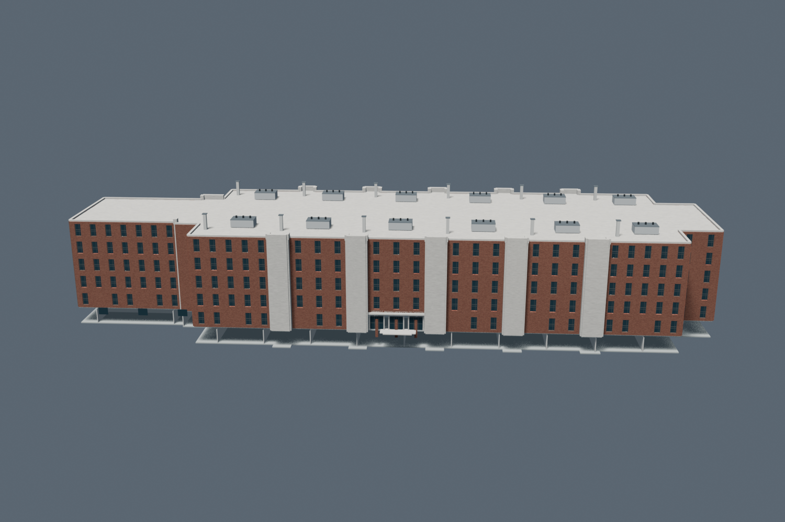
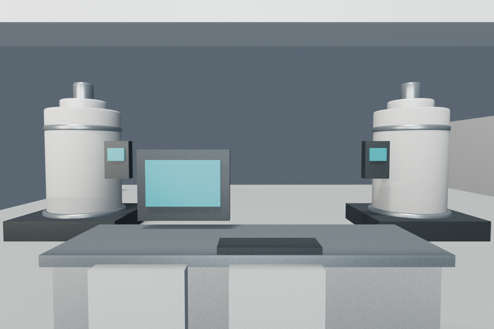
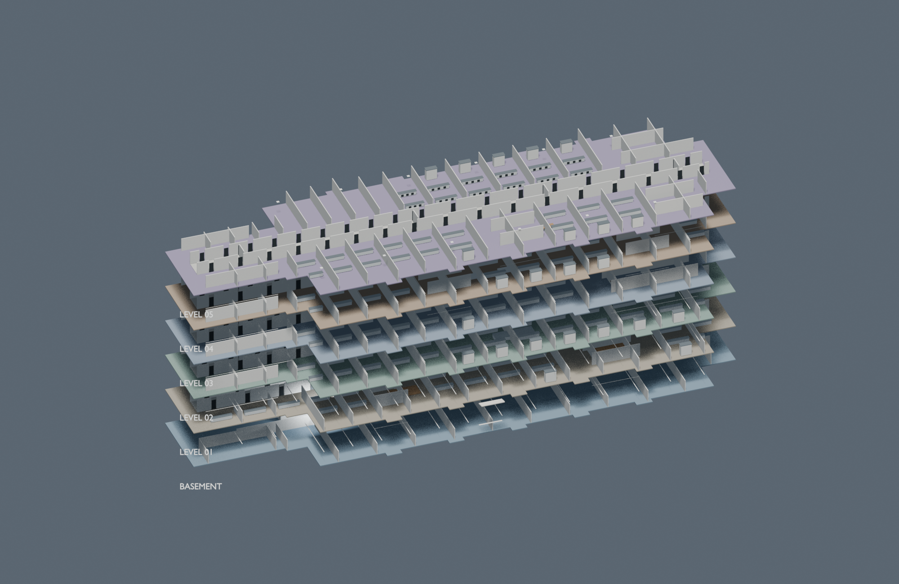

# Brown Laboratory of Chemistry — asset and QA record

**Asset:** `modular/buildings/brown_laboratory_of_chemistry.blend`  
**Audit date:** 2026-10-23  
**Result:** Standalone file rebuilt, freshly reopened and audited. **Revised score: 8.6/10.**

## Deliverables

- Standalone Blender asset: [`brown_laboratory_of_chemistry.blend`](../../modular/buildings/brown_laboratory_of_chemistry.blend)
- Exterior preview: [`brown_exterior.png`](brown_exterior.png)
- Basement L8124 instrument room: [`brown_interior_lab.png`](brown_interior_lab.png)
- Render-only vertical cutaway: [`brown_cutaway.png`](brown_cutaway.png)
- Individual level views: [`brown_basement_cutaway.png`](brown_basement_cutaway.png), [`brown_floor_01_cutaway.png`](brown_floor_01_cutaway.png) through [`brown_floor_05_cutaway.png`](brown_floor_05_cutaway.png)
- Reopen audit script: [`reopen_audit.py`](reopen_audit.py)
- Rebuild script: [`build_brown.py`](build_brown.py)

## Placement and portability

- The source massing footprint is retained in local coordinates. The asset root is at local `(0, 0, 0)` with unit scale.
- All interior batch geometry (walls, casework, counters, hoods, equipment, painted metal, wood, safety details and corridor finishes) is clipped against the imported source polygon using cross-sections offset by half its thickness. The builder checks every contained batch before saving; the reopen audit repeats the check against all non-exempt interior meshes.
- **Master placement marker origin:** X `145.5986824 m`, Y `-90.6512413 m`, Z `0 m` (campus coordinate frame: X east, Y north, Z up).
- Collection: `Asset_brown_laboratory_of_chemistry`; scene: `Building_brown_laboratory_of_chemistry`.
- Reopen check: 72 collection objects, 57 mesh objects, 17 used materials. Every mesh has a material; all objects are parented to the asset root; no linked libraries or unpacked external images were found.
- Local mesh bounds: X `-56.35..56.35 m`, Y `-19.53..18.21 m`, Z `-3.21..18.81 m`. The source massing height is 16 m; higher roof details are inferred.
- The south-side cutaway render temporarily removes the front exterior skin and floor plates only for that render. The original geometry is restored before the `.blend` is saved.
- The cutaway is an exploded presentation with six separated level bands (basement plus five floors), reducing overlap. Individual plan-like views are supplied for each story. Doors are placed in corridor-wall openings with cross partitions starting beyond doorway clearance; the basement NMR entry aligns to its wall opening. These modeled clearances are not a physics-based collision test.
- The NMR interior preview uses a render-only basement-height geometry slice, excluding upper floors and the overhead slab to remove camera obstruction. The full asset is restored before final save.
- The basement NMR presentation now includes a control workstation, monitor, keyboard, console, chairs, service collars, cryogen/utility dewars and regulators. These are generic illustrative details inferred from common instrument-room needs; they are not documented as the specific equipment installed in L8124. The unsupported blank wall panel was removed. The cryostat side faces are smooth and matte, and the operator panels sit clear of the shell to remove the prior diagonal visual seam. The exploded cutaway uses restrained, distinct floor plate colors for story separation; those colors are render-only.
- The landing and stair treads are separate, tagged exterior threshold objects and are the only containment exemptions. The entrance is visible in reference imagery; their exact projection beyond the wall footprint is inferred.
- No master blend, source massing file, manifest, or shared script was edited.

## Research and plan-based interior layout

Research and image retrieval were done on 2026-10-23. All six Purdue plan sheets are saved here: `brwn-b-floorplan.jpg` and `brwn-1-floorplan.jpg` through `brwn-5-floorplan.jpg`.

[Purdue Chemistry — Brown Laboratory plans](https://www.chem.purdue.edu/building/) links the official basement and floor sheets: [basement](https://www.chem.purdue.edu/images/building/brwn-b.jpg), [first](https://www.chem.purdue.edu/images/building/BRWN-1.jpg), [second](https://www.chem.purdue.edu/images/building/brwn-2.jpg), [third](https://www.chem.purdue.edu/images/building/brwn-3.jpg), [fourth](https://www.chem.purdue.edu/images/building/brwn-4.jpg), and [fifth](https://www.chem.purdue.edu/images/building/brwn-5.jpg). Their compass indicates north up. Registration is an axis-aligned envelope fit: follow north-up (+Y north, +X east), align each sheet's outer footprint bounds independently in X and Y to the preserved source massing's GIS-derived XY envelope (about 112.22 x 35.76 m), then trace room edges proportionally inside it. Independent axis fits account for scan distortion. This anchors the outside bounds but does not provide surveyed interior coordinates; partitions remain estimates, generally uncertain by about 1–2 m or more. The scans have no dimensions or control points for a georeferenced transform.

The interior is now differentiated by level instead of reusing one room grid:

- **First floor:** west end offices and small rooms; general chemistry and journal-office zones toward the north-central area; smaller service/server and staff areas on the south-central side; research labs elsewhere.
- **Second floor:** west-side main-office and copy/procurement cluster; organic preparation area at the east end; a preparation suite near the south-central wing; research labs along the remaining wings.
- **Third floor:** north-side instrument-facility zone and laboratory rooms; analytical teaching area toward the southeast; west-end smaller rooms and south-side offices.
- **Fourth floor:** west conference rooms; distinct south-central instrument suite and office rooms; research labs across the remaining bays.
- **Fifth floor:** west-end instrument room; varied research suites and central/east office clusters.
- **Basement:** the official plan labels the large northwestern instrument room **L8124 / NMR**. The model now places the NMR suite there, with a south-facing corridor entrance. It also models the long basement corridor and the separate west-end **B103 prep lab / chemical storage** room called out on the sheet.
- Core markers now repeat at four approximate stair/lift positions across the five levels, with distinct transverse room divisions per sheet. Exact core dimensions and shaft alignments remain schematic.

The plans include room-use annotations and colored research-group assignments. Those labels may not certify current room uses or as-built partitions; they guided broad zones, not claims that every office, instrument, or partition is current.

## Other references and evidence limits

1. [Purdue Office of Emergency Preparedness — BRWN](https://www.purdue.edu/operations/emergency-preparedness/brwn/): retrieved 2026-10-23; page revision shown as 2026-04-03. Identifies five above-grade floors plus basement and Brown's address as 560 Oval Drive. This supports story count and basement, not exact dimensions.
2. [1999 exterior photograph](https://www.asergeev.com/pictures/archives/compress/1999/91/16.htm) (page dated 1999-06-15; [direct image](https://www.asergeev.com/pictures/archives/1999/91/jpeg/16.jpg)): historical visual reference for red-brown brick, pale projecting concrete, narrow dark windows, flat roof, and entry. It cannot establish every current facade feature.
3. [Purdue Chemistry — building history](https://www.chem.purdue.edu/mellon/buildings.html): historical context for the Brown addition and 1973 opening.
4. [J.W. McQuiston — Purdue Brown/Wetherill renovation](https://www.jwmcq.com/purduebrownwthr): 2015 lab/classroom renovation context; does not establish current room-by-room finishes.
5. [Google Maps pin near Brown Lab](https://www.google.com/maps/@40.426584,-86.911984,18z/data=!3m1!1e3): linked for geographic context. Live 3D imagery and capture date were not reliably inspectable, so no current facade measurement or claim depends on it.
6. [Purdue campus building footprint service](https://services1.arcgis.com/mLNdQKiKsj5Z5YMN/arcgis/rest/services/BuildingShapesZip4/FeatureServer/0): project source record identifies feature 247 / BRWN. The provided source massing footprint was retained. The audit row does not independently document its coordinate reference system; project campus-metre coordinates were preserved as supplied.

### Supported detail versus inference

- **Supported:** source-massing footprint; five above-grade floors and basement; broad brick/concrete/window vocabulary; room/core organization at the level shown in the official plans; the basement L8124/NMR room and B103 prep/storage zone labels.
- **Still inferred:** proportional metric location of floor-plan partitions because the scans have no registered GIS scale; exact current room occupancy; NMR magnet count/type and equipment detail; internal finishes and furniture; precise roof vents and mechanical plant; exact window rhythm and some concrete-bay dimensions.
- **Uncertainty:** no measured roof-height survey, current exterior photo, as-built partition survey, or accessible Google Maps capture date. The source massing is 16 m high; modeled roof details raise the total bounds to 18.81 m.

## QA and score rationale

- Reopened in Blender 5.2.3 LTS and checked scene/collection names, root transform, hierarchy, material slots, linked libraries, and image dependencies. See [`reopen_audit.py`](reopen_audit.py).
- The six official scans are north-up. Their outside envelopes were aligned independently to the source footprint bounds on the project axes, with separate X/Y fits for raster distortion. Internal walls remain estimates, generally uncertain by about 1–2 m or more. No control points or dimensions support survey-level registration.
- The stacked cutaway now uses an elevated three-quarter view, an 8 m render-only level pitch and explicit story tags to make the six levels easier to distinguish. Six individual top views remain available for inspection. Exploded copies, tags and contrasting floor plates are removed/restored before saving the actual asset, which retains its 3.2 m story spacing.
- A dimension check verifies each 0.92 m door leaf fits its 1.12 m opening, corridor door centers stay clear of the room-divider grid, and the basement NMR leaf fits the south-wall gap. This is a targeted plan-coordinate check, not a general 3D collision engine.
- All nine previews were regenerated: exterior, NMR interior, exploded six-level cutaway, and one plan-like view for each of the six levels.
- Fresh reopen in Blender 5.2.3 verified scene/collection names, 72 objects, 57 meshes, 17 used materials, unit root transform, rooted hierarchy, material slots, and absence of linked libraries or unpacked external images. It tested **17,560 vertices across 50 non-exempt interior meshes** against the saved 56-point source polygon; **0** were outside or off the boundary. Only the explicitly tagged landing and stair treads are excluded as intentional exterior projections. All nine previews are present. See [`reopen_audit.py`](reopen_audit.py).
- Builder and fresh-reopen checks confirm every final `Interior_Partitions` vertex lies inside or on the local source footprint; clipping accounts for wall thickness so the narrow ends no longer overrun the slabs. A separate door-opening dimension check verifies the leaves fit openings and miss the divider grid.
- **8.6/10:** containment is checked across all 50 relevant saved interior meshes, not only room partitions; doorway clearances and the basement preview presentation are also verified. The NMR room has illustrative operator/support detail, the cryostat seam and unsupported floating panel are corrected, and cutaway levels are easier to distinguish. It remains below 9 because room registration is proportional rather than survey-based, current facade/as-built interior evidence is missing, and some room uses, dimensions, equipment and roof details remain inferred. This is a visual/research score, not survey accuracy.
