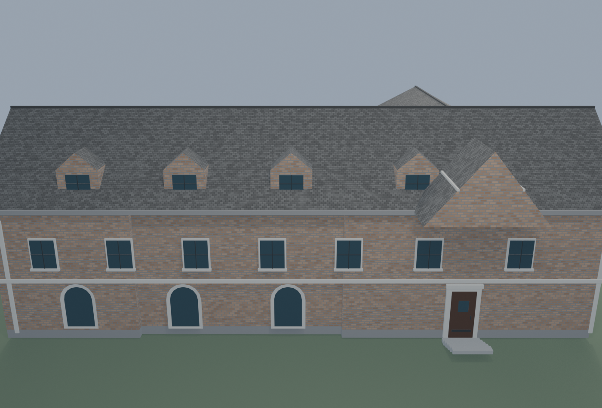
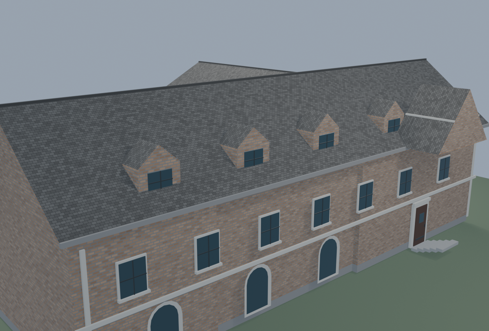

# Delta Sigma Phi (Delta Delta), Purdue — Asset Evidence

**Status:** detailed exterior asset independently graded 8.3/10; coordinator master integration pending. **Identity:** confirmed as 341 Northwestern Avenue, West Lafayette, Indiana. **Assigned GIS feature:** Purdue Campus Map BuildingShapes FID 798 (`BUILDING_N=Delta Sigma Phi`, `ADDRESS=341 Northwestern Av`, `OWNER=GREEK`).

## Source match and footprint

The README crosswalk lists both `massing_house_860826640_baa087e` and `massing_house_860826641_2c90f97` as candidates for FID 798. The official FID 798 geometry and address identify `massing_house_860826641_2c90f97` as the assigned Delta Sigma Phi source; the 860826640 candidate is adjacent. The official polygon comes from the Purdue-linked `BuildingShapesZip4` ArcGIS service; its raw WGS84 response and layer metadata are preserved in `sources/`.

- Retrieved: 2026-10-26. Response geometry CRS: EPSG:4326. Source layer metadata CRS: WKID 102100 / latest WKID 3857.
- Project approximation: origin 40.4274° N, 86.9137° W; X = (longitude + 86.9137) × 84810.60416539927 m, Y = (latitude − 40.4274) × 111040 m; X east, Y north, Z up. This is a local approximate transform, not surveyed coordinates.
- Local building frame: centered on source polygon centroid (357.740058, -73.829742) m and rotated by 129.444055° east-CCW along the source minimum rotated rectangle.
- Source ring: 22 edges; projected geometry area 498.110 m², perimeter 119.335 m.
- The GIS `Shape__Area` / `Shape__Length` attributes report 861.027 m² / 156.904 m, conflicting with the returned ring after the documented local transform (498.110 m² / 119.335 m). The polygon ring was used for the walls; the conflicting attributes were not used.
- Original massing-vs-GIS footprint comparison: approximate IoU 0.9166, symmetric difference 43.74 m², Hausdorff distance 2.22 m. The replacement exterior wall vertices match the FID 798 polygon within 8.64e-07 m. Roof overhangs, dormers, entrance and steps are excluded from that wall-footprint comparison.

## Photo evidence

- Google Street View at 339 Northwestern Ave, pano `_pIsdy9qsEkhXRqClC_kvg`, capture Mar 2026, retrieved 2026-10-26; the view is oriented toward 341 Northwestern. The facade reference shows buff/brown brick, dark steep roof, prominent cross-gable, dormers, upper windows, arched lower openings and entrance steps. Saved as `sources/google_street_view_2026-03_front.jpg`.
- Google Street View at 339 Northwestern Ave, pano `_nIbZNYrUjcqQ-V7nnBCfQ`, capture Jun 2009, retrieved 2026-10-26. Tree cover hides much of the facade; it supports the enduring tall-gable/brick massing, not fine facade details. Saved as `sources/google_street_view_2009-06_oblique.jpg`.
- The chapter address was independently identified by the chapter-associated location listing and the West Lafayette 2020 Downtown Plan (which calls 341 Northwestern the Delta Sigma Phi House); the Purdue-hosted chapter page likewise gives 341 Northwestern Avenue. URLs and retrieval dates are in `sources/source_register.json`.

## Geometry and limits

Replaced the single 13-vertex massing block with a local-coordinate, textured exterior: exact GIS footprint wall perimeter and plinth, a long two-story facade, dark slate/shingle roof, four dormers, one projecting entry cross-gable, three arched lower windows, upper-floor windows, limestone trim, a rear perpendicular roofed wing, entry door and short concrete steps. Materials are procedural and self-contained. No image textures, external libraries, floor plans or interior geometry are included.

Wall height 7.55 m and roof ridge 11.95 m are estimates inferred from Street View story rhythm, with roughly ±2 m uncertainty. The official GIS `NUM_LEVELS=1` and `Extrution=12` fields conflict with visual multi-level evidence and were not treated as reliable height measurements. No measured height or hidden interior is claimed.

## Fresh-open validation

Opened the saved file in a separate Blender 5.2.3 LTS process. Stable scene `Building_massing_house_860826641_2c90f97` and collection `Asset_massing_house_860826641_2c90f97` are present. The exported collection contains 165 objects (164 meshes), 1062 mesh vertices, 609 polygons, and 8 materials. The file has no external image or linked-library dependencies.

- Local bounds (m): X [-21.732, 20.609], Y [-16.501, 16.733], Z [0.000, 12.010].
- Proposed master placement origin: (357.740058, -73.829742) m; projected world bounds including roof, entry and stairs: X [336.008, 378.349], Y [-90.331, -57.097], Z [0.000, 12.010].
- Asset SHA-256: `1f1b3efa2fd0d3dd756ccbd6556ee5a4f8fce0539eae0f5088e1190c8992c976`.
- Detailed numeric report: `fresh_open_validation.json`. Source register and raw source snapshots: `sources/`.

The coordinator converted the source entry to a detailed collection instance at the proposed centroid and rebuilt the master. Independent review passed at 8.3/10 on the exact asset SHA; see `independent_grade_codex/result.json`. A separate fresh-open of `purdue_campus_master.blend` passed: the expected linked library and `Placement_massing_house_860826641_2c90f97` marker resolve at the documented centroid, bounds agree with the manifest within 0.001 m, and no direct campus-root duplicate remains. See `master_integration_2026-10-26.json`.
