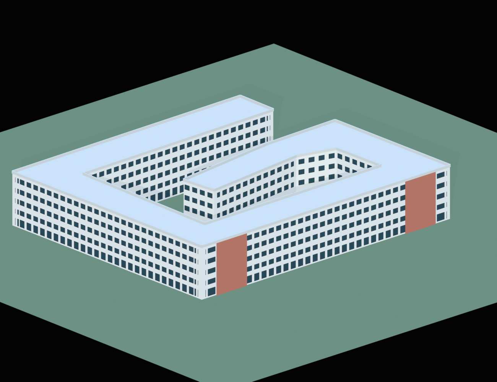

# 3rd and West evidence record

## Result

The existing one-mesh 16 m block was rebuilt into a five-story campus-coordinate shell based on the 14-node OSM outline for way 1324500897. The structural outline agrees with its source nodes within 0.00006 m (float32 mesh precision). The revised asset contains 19 mesh objects in the expected `Asset_massing_3rd_and_west_ffa3d05` collection.

## Source evidence

- OpenStreetMap way 1324500897: [map feature](https://www.openstreetmap.org/way/1324500897). The cached source snapshot has WGS84 coordinates and an Overpass snapshot timestamp of 2026-10-22 03:45:50 UTC; an individual edit timestamp is unavailable. The project’s documented local approximation was used to convert those coordinates to campus X/Y in meters.
- Purdue University Residences: [opening feature](https://housing.purdue.edu/get-reconnected/2025/08/special-feature.html), published August 2025. The page identifies the Third Street/McCormick Road site, states that the building is five stories, and includes the 3rd and West exterior photo credited to Purdue Research Foundation / Dave Mason.
- Purdue Research Foundation / Discovery Park District: [project description](https://discoveryparkdistrict.com/3rd-and-west-activation-project/), stating five stories, 325,000 square feet, a prominent entry plaza, and dual courtyards.
- SCB Architecture: [project description](https://scb.southleft.com/project/3rd-and-west/). It describes north/public and south/private landscaped courtyards, transparent ground-floor amenities connecting them, full-height corner study spaces, patterned Norman brick and glazing, and shifts in facade depth. A text capture is saved in `sources/scb_page_text_capture.txt`; the host did not resolve for a raw HTML download in the shell session.
- American Campus Communities: [project page](https://www.americancampus.com/news-and-insights/new-student-housing-opens-through-purdue-research-foundation-and-american-campus-communities). The saved project description independently confirms five floors and dual courtyards.

Raw OSM nodes and way are in `sources/osm_way_1324500897_snapshot.json`. Fetched HTML snapshots and the official Purdue photo are in `sources/`.

## Measurements and edits

The OSM outline encloses 5,553.922 m² and spans approximately 108.600 m east–west by 91.475 m north–south. The shell preserves each source node and is extruded to 18.0 m. Five stories are supported by official project sources; the 3.6 m floor module and 0.9 m parapet are estimates, giving a modeled total of 18.9 m. The earlier asset used the same approximate bounds but one undifferentiated 16 m mesh.

The new asset adds five-level facade rhythm, dark glazing and mullions, a flat roof/parapet, and two brick end accents drawn from the official photo and architect description. The fenestration spacing, brick feature dimensions and positions, and all vertical dimensions are illustrative because the public sources do not provide measured elevations.

## Reopen validation

`reopen_validation.json` records that the saved library reopened, contains the manifest scene and collection, has no preview camera/light/ground objects outside the asset collection, and has no external image, font, or linked-library dependencies. `linked_collection_probe.json` records that the expected collection links into a fresh empty Blender file with all 19 mesh objects. The shell’s transformed source vertices match within 0.00006 m. The full asset extends up to 0.26 m beyond the structural footprint due to facade components; structural bounds remain on the source outline.

## Remaining uncertainty

The cached OSM geometry is the modeled footprint, so its exact match to the new shell is an input consistency check, not independent verification. No independent current survey/official GIS outline was located. The story count is supported, but exact height, roof details, bay widths, brick volumes, facade materials, and courtyard landscape dimensions remain unverified or estimated. Independent grade is pending.
