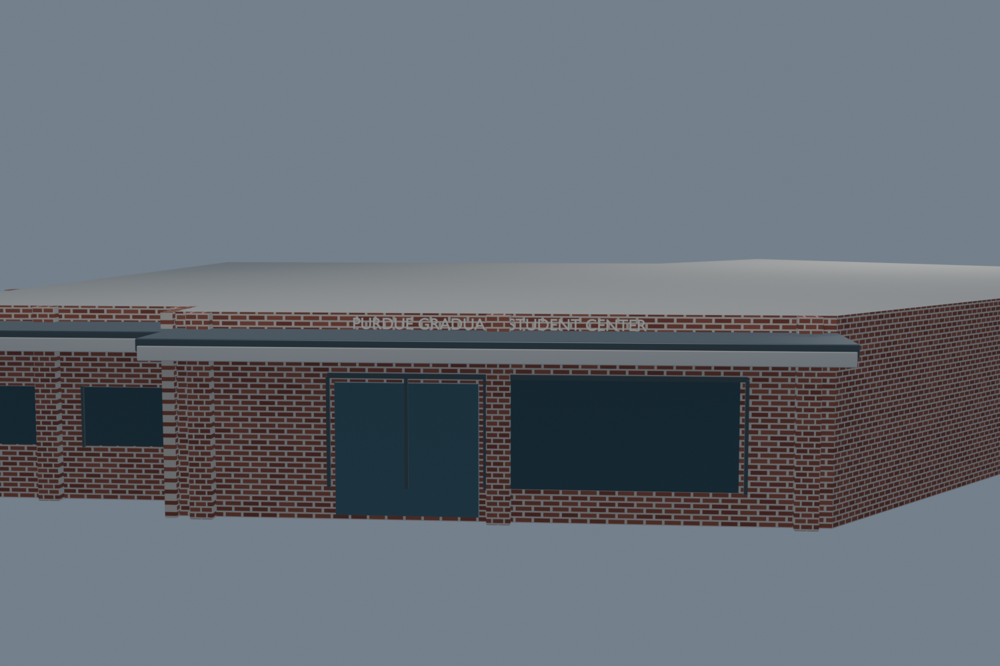
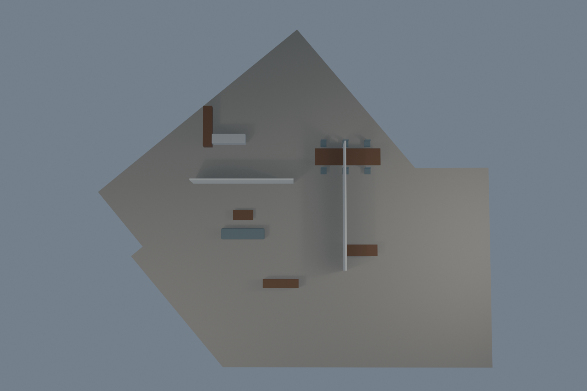

# Purdue Graduate Student Center asset evidence

**Asset:** `massing_purdue_graduate_student_center_af9c5c7`  
**Assignment:** README assigns this building to Tobin.  
**Saved asset:** `modular/buildings/massing_purdue_graduate_student_center_af9c5c7.blend`  
**Builder:** `modular/buildings/build_massing_purdue_graduate_student_center_af9c5c7.py`

## Identity and integration boundary

Purdue GIS feature 526 identifies PGSC at 504 Northwestern Avenue. Purdue Archives says PGSC occupies the former Visitor Information Center portion of Northwestern Avenue Parking Garage. This asset models the low PGSC portion; it does not recreate the garage's upper parking decks. The master uses a deterministic, watertight cutout proxy generated from the PGSC GIS footprint. It preserves the linked Northwestern Avenue Parking Garage source library unchanged and clears the PGSC volume through z=4.5m; see `master_integration.json` and `../master_sync_pgsc_2026-10-26.json`.

## Source records

All sources were retrieved 2026-10-26 unless otherwise noted. Full provenance, source IDs, URLs and uncertainty notes are in `evidence.json`.

- [Purdue Graduate Student Center page](https://purdue.edu/academics/ogsps/current-graduate-student-resources/purdue-graduate-student-center-pgsc/) — official building/program description, exterior and room images.
- [Purdue Archives PGSC record](https://archives.lib.purdue.edu/agents/corporate_entities/895) — confirms location within the Northwestern Avenue Parking Garage and the Visitor Information Center history.
- [Purdue BuildingShapesZip4 GIS feature 526](https://services1.arcgis.com/mLNdQKiKsj5Z5YMN/arcgis/rest/services/BuildingShapesZip4/FeatureServer/0/query?where=FID%3D526&outFields=*&returnGeometry=true&outSR=4326&f=geojson) — polygon, address, level count and source height attribute. Cached under `sources/` with layer metadata.
- Google Maps Street View, panorama `u149QOTu5LDQAa6qdW4bkw`, imagery dated 2025-08 — street frontage and garage relationship. URL and retrieved tiles are under `sources/`.

## Model contents and limitations

The model contains a GIS-footprint shell, modular brick material, southwest/west-facing brick frontage, storefront glass and doors, piers, canopy/fascia, raised PGSC lettering, interior floor, schematic partitions and source-described furniture. Ten procedural materials are packed into the asset with no external image files. The interior layout is illustrative: Purdue sources describe room functions but provide no measured floor plan. GIS `Extrution=12` has undocumented units; 3.65m is a feet-based estimate, not surveyed height. See `build_metrics.json` and `fresh_open_validation.json` for measured bounds and technical checks.

## Validation

Blender 5.2.3 opened the saved asset from disk in a separate process. It found the expected stable scene/collection, 63 geometry objects and 10 used materials; no external texture paths were present. The SHA256 is recorded in `fresh_open_validation.json`. Independent grading scored the exact saved asset **8.6/10**. The master placement and garage interface independently reopen and pass; the latest master SHA and checks are recorded in `../master_sync_pgsc_2026-10-26.json`. The 3.65m height remains an estimate and the interior layout remains schematic.
