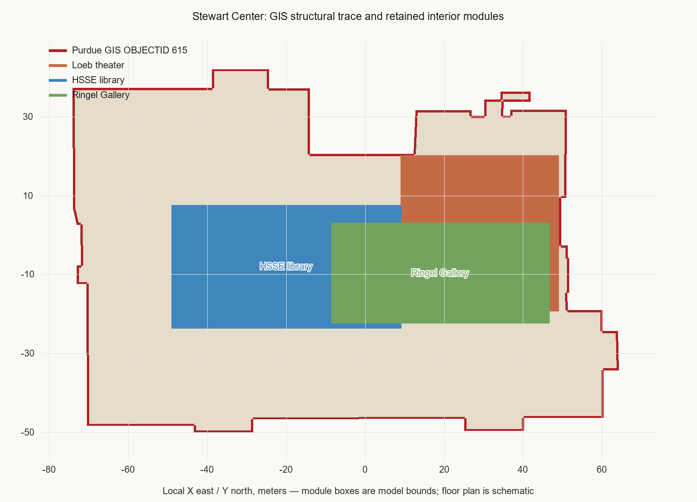

# Stewart Center independent grade

**Result: 6.0/10 — does not meet the 8/10 pass threshold.**  
Asset reviewed: `modular/buildings/stewart_center.blend`, freshly reopened in Blender.  
Asset SHA-256: `109e7089bcadd6b003070adf82db9ac5d2231766733b3538d3e5d8ac6caadbc8`.

The grade applies the five two-point criteria in `AGENT.md`. The saved asset was opened directly and its evaluated scene/collection, materials, named exterior-wall meshes, bounds, and generated views were inspected. The master file was not reopened, so this report does not certify the master instance or neighboring context.

| Criterion | Score | Assessment |
|---|---:|---|
| Identity and source-backed footprint | 1.2/2 | Identity is supported by Purdue GIS. The model covers nearly all the source polygon, but its structural envelope is much more rectangular than the stepped GIS outline. |
| Position, orientation, scale/dimensions | 1.6/2 | Local root and manifest location are consistent; the GIS overlay broadly aligns. East extent is about 4 m overlong. Master marker placement remains unchecked. |
| Evidence-backed height, floors, roof | 1.0/2 | Purdue sources support three floors in the central part. The model's 16.5 m wall top, 22.5 m overall height, and flat-roof equipment forms lack authoritative dimensional evidence. |
| Facade, entrance, distinctive architecture | 0.7/2 | Brick, repeated window grids, horizontal bands, and a simple entrance are present. The render does not capture the source-supported entrance and complex's distinctive historic volumes. |
| Modular export, portability, evidence | 1.5/2 | The named scene and collection freshly reopen; root is at local origin; all 1,349 meshes have materials and no external image paths are missing. Building-specific source/elevation evidence is incomplete. |

## Footprint comparison

The authoritative source is Purdue campus GIS feature OBJECTID 615 (`STEW`, `Stewart Center`) from the [Purdue campus GIS MapServer layer](https://mapsweb.lib.purdue.edu/arcgis/rest/services/Purdue/campus/MapServer/0). The service uses EPSG:3857; the feature was requested in EPSG:4326 and transformed with the project’s approximate local coordinate conversion around its manifest origin. This is a local comparison, not survey-grade georeferencing.

The model comparison uses the axis-aligned bounds of the eight objects named `STEW_Ext_Wall_*`, rather than including windows, roof edges, stairs, or plaza elements. The official polygon is approximately 10,197 m²; the model wall envelope is 12,442 m². The rectangle covers about 99.6% of the polygon, but covers only 81.6% of its own envelope with the official polygon (IoU ≈ 0.814). The overlay shows substantial source recesses and edge projections that are omitted from the current box form. Hausdorff distance is approximately 21.9 m, driven by these outline differences. See [footprint overlay](footprint_overlay.png) and the raw GIS response `purdue_gis_feature_615.json`.

## Visual and source review

Fresh Blender views: [south oblique](south_oblique.png), [north oblique](north_oblique.png), and [top view](top.png). They show a mostly rectangular, flat-roofed mass with three rooftop blocks, repetitive facade grid/bands, and a small entry treatment. The temporary review camera/light overexposes some light materials, so these images are useful for massing and facade layout, not final material-color grading.

Purdue Archives documents construction from 1954 to 1958, states the central part has three floors, and describes the complex as incorporating the existing University Library and reconstructed Fowler Hall. The [Purdue Road School floor maps](https://roadschool.purdue.edu/maps/Stewart%20Center%20Maps.html) corroborate first-, second-, and third-floor organization, but are not dimensioned elevations. The [Purdue archives history](https://blogs.lib.purdue.edu/news/2017/08/27/from-the-archives-a-beginning/) also notes a mural above the HSSE library entrance. The [Purdue events page](https://events.purdue.edu/stewart_center) provides a visual exterior reference with a distinctive columned/stone-framed entrance and broad stairs. The asset's current main entrance is simplified, and its library/Fowler Hall composition and mural location are not legible in the inspected views.

## Actionable corrections

1. Rebuild the structural walls to follow the GIS's stepped plan, especially the recesses and east-side projections; do not stretch the current rectangle to the GIS bounds.
2. Model source-supported distinct volumes for the incorporated library and reconstructed Fowler Hall, using plans or photographs to identify where each belongs.
3. Refine the principal entrance, column/stone surround, broad stairs, and library entrance. Place the mural only after confirming its exact facade/location from a reliable photograph.
4. Find authoritative elevations or roof plans before treating the current heights and rooftop blocks as verified; retain them as estimates until then.
5. Reopen the master and verify its `Placement_stewart_center` instance against the manifest. Add a building-specific evidence record that includes source dates, CRS/transform, measurement method, uncertainty, and preview images.

## Evaluation artifacts

- `evaluate_stewart.py` implements and runs the criterion-level evaluator.
- `independent_grade.json` is the generated structured result, including `{score, max_score, criteria, evidence, findings}` and source provenance.
- The other JSON and Python files in this folder record the fresh-open and wall-geometry probes used for review.
