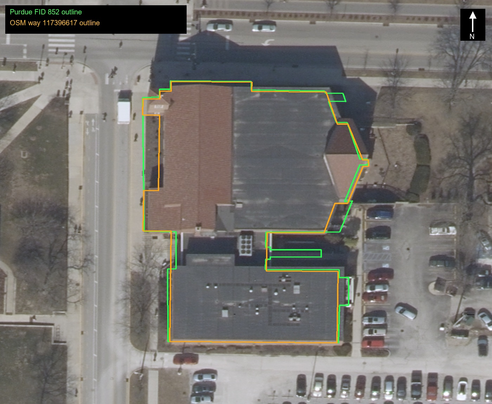

# St. Thomas Aquinas Center — second-pass exterior research

**Queue rank:** 47 · **Stable ID:** `massing_st_thomas_aquinas_5535390` · **Owner:** Unassigned
**Review date:** 2026-10-30 · **Status:** Exterior research package prepared with substantial gaps retained; provisional, not build-ready. This pass establishes the correct Purdue identity, three connected building components, historical church expansion, one corner/façade family, current maintenance chronology, and map/roof-plan constraints. It does not establish a complete all-face schedule, exact current component seams, or measured height.

## Identity, phases, boundary, and reference condition

This is the **St. Thomas Aquinas Catholic Center at Purdue**, 535 Mitch Daniels Boulevard (historically indexed as 535 State Street), at the campus edge. Purdue GIS BuildingShapes feature FID 852 names “St. Thomas Aquinas Center,” uses address `535 STATE ST`, and places the mapped shell immediately west of the north–south street. The parish’s current Project Renewal page confirms three physically connected parts: the original church, a new church addition, and an office/classroom addition (G1, H1). The 2023 north-up image shows a large church roof zone to the north and a broad flat/low-slope roof zone toward the south, but public material does not tie exact roof polygons to those three component names. Component partitioning in the prior audit is therefore a working diagram only, not a verified construction seam map.

The locally projected Purdue outline is about **2,173.60 m²**, **271.06 m perimeter**, with bounds **42.76 m east–west × 65.01 m north–south** (project-local XY; G1, G4). Its 43 distinct corners include several offsets/recesses. OSM way 117396617 independently overlaps the Purdue outline at **IoU 0.9224** (G3, G4). The 2023 imagery confirms a connected, multi-roof complex and its relation to the street corner. Neither GIS outline is a survey or a surveyed wall line. The exact foundation-to-GIS match reported in the prior R4 model audit (IoU 0.99999996) only shows that the model follows that GIS ring; it does not independently verify the building perimeter (G4).

A contemporary 1964 *Indiana Architect* account identifies a chapel built in **1950**, seating about **350**, and describes the remodeling/addition then being awarded: a new nave and sanctuary adjacent to the earlier chapel, a pierced east wall, and reorientation of the former sanctuary east–west so it could blend with the addition. The new church was described as semi-circular seating for about **800**, with seats within 60 ft of the altar. The article says the remodeled complex was dedicated May 3, 1964, and lists concrete, concrete block, steel, brick, and wood as materials. These are historical facts about the 1964 project, not a complete as-built description of current phases (P1). The article’s small plan and “View of Remodeled Exterior” photo are valuable period layout/form evidence; they cannot establish current openings or what survived subsequent work.

**Current exterior condition:** the parish reports office/classroom window replacement begun in 2019 and completed summer 2025; center-church accessibility ramp and two new confessionals completed spring 2026; bell-tower interior LED and cross lighting completed summer 2026; and flashing plus masonry repairs above the Gather Space completed spring 2025. A broader masonry project, including the brick wall behind the altar and other masonry, remained in design review on the inspected 2026 page, with bids hoped for before year-end. Church window repair/replacement was under architectural discussion in summer 2026 without a set scope, price, or timeline. Do not portray those planned masonry/window works as completed. The parish says the Gather Space roof itself remains in good condition (H1).

**Identity correction:** the former R4 audit cited the J.W. McQuiston “St. Thomas Aquinas” project page as if it documented this Purdue church. That page says its campus dates from 1940 and explicitly calls out a “View from 46th St.”; it describes a 2001 project. Those clues identify a different St. Thomas Aquinas campus in Indianapolis. It is excluded from this Purdue dossier and must not be used to assign Purdue facade materials or phases. The 1964 Purdue-specific issue, Purdue GIS, current Purdue parish page, and exterior photos with Purdue context are retained instead. The prior R4 audit’s general footprint comparison remains useful as a model-to-GIS check, but its McQuiston reference is not identity evidence.

## Inspected views and what each actually covers

| ID | Source/view | Observations usable for exterior work | Station, date, and limits |
|---|---|---|---|
| **P1** | *Indiana Architect*, Sep. 1964, p.13; full issue PDF and rendered page retained. | Period exterior view shows a low, broad brick church composition with a lower horizontal roof band, a taller projecting/gabled volume and recessed entry zone. The page’s small plan and text establish the former chapel/new nave relationship and semi-circular seating concept. | Contemporary print, reproduced at low resolution. Camera position and precise orientation are not given. It documents the 1964 remodeled design, not present condition; small plan cannot support dimensional tracing. |
| **P2** | WBAA image published with the Jun. 30, 2017 story; 1024×768 image retained. | Nearer street oblique of one public-facing composition: long, low brick wall with high horizontal dark glazing band; a pale vertical panel with staggered narrow slots; shallow projecting entrance canopy and doors; taller brick gable/tower zone at the right; square bell-tower openings and cross; dark/gray foundation plinth. | Article date is 2017-06-30; image capture date, photographer, camera station/heading and height are unstated. A banner, signs, shrubs and cars obscure or date the image. One corner/face family only. |
| **P3** | Home of Purdue St. Thomas listing, image filename `Screen-Shot-2020-11-03-at-2.01.00-PM`; retained JPEG. | A wider, more frontal view of substantially the same corner composition as P2. Confirms that the long wall, clerestory band, slotted pale strip, canopy/entry and taller bell-tower/gable mass coexist in one facade composition. The image also shows sidewalk, curb and street context. | Filename suggests a 2020-11-03 screenshot, not necessarily capture date. Camera location/bearing and photographer are unknown. Does not add a separate elevation; poles/traffic equipment cross the facade. |
| **P4** | Dave Wegiel / Pinola Photo, article dated Jan. 3, 2025 capture and posted Nov. 30, 2025; 800×534 JPEG with EXIF. | Snowy night corner oblique shows the square tower at a street intersection, cross, two adjacent tower faces with tall geometric openings, gabled church volume, projecting low entrance roof, glazed door group and a receding side elevation with several tall narrow windows. It is the best retained evidence for the corner/tower depth and a second adjoining face. | EXIF: Sony ILCE-7RM3, 2025-01-03 12:15:55; no GPS. Night lighting, snow, long perspective, wet reflections and small 800×534 output constrain color and opening measurement. |
| **A1** | Indiana 2023 ImageServer orthophoto, north-up crop and no-fit overlay (retained with exact request/returned extent). | Shows the complete overhead outline, roof changes, a large north church zone, south wing roof/equipment, recesses between roof areas, and the building’s street/corner context. Purdue FID 852 is green; OSM way 117396617 is orange. | Service does not expose the flight day or roof-to-wall offsets in this response. Tree shadows and roof edges cannot locate the exact wall/foundation. 1400×1150 crop is useful for plan/massing, not elevations. |
| **G1–G4** | Purdue GIS FID 852/schema, OSM way 117396617, and prior project-local comparison. | Independent map identity and broad footprint/position; no-fit orthophoto overlay illustrates small but visible outline differences. | Not an as-built plan. GIS `NUM_LEVELS=1`, `CountOfFLO=1`, `Extrution=30`, and `Elevation=618` are not reliable story/height values without field semantics; building is visibly multi-level in places. |
| **R1** | Prior R4 exterior renders and design evidence in `audit/st_thomas_aquinas_5535390/`. | Helpful for describing what the current asset assumes: pitched sanctuary roof and cross tower meeting flat-roof wings, schematic component joints, and extant entry compositions. | Model output is not evidence of the real building. Do not use render-derived heights, floor count, roof pitch or facade schedules as verified building facts. |

The overlay is plotted in the ImageServer’s returned WGS84 extent without moving the imagery to fit either map polygon. It supports the broad roof organization and documents mismatch; it does not settle the exact wall line.

## Facade and opening schedule: source-limited, image-relative

Cardinal assignment of the P2/P3/P4 photographed surfaces is not proven by camera metadata. Use “long low wall,” “slotted strip,” “tower/gable face,” and “receding side” below until a mapped camera station or field walk assigns them to north/east/south/west. The orthophoto shows that the parish occupies the corner, but it does not by itself identify which photographed side is the north or west wall.

| Face/run and direction of reading | Observed sequence / features | Confidence and unresolved portions |
|---|---|---|
| **Long low wall in P2/P3**, read from visible left end toward tower junction | One continuous-looking upper clerestory strip under the roof edge; large comparatively blank brick wall beneath with church-center lettering; a tall light-colored vertical panel near the entry, pierced by several staggered narrow rectangular slots; low projecting flat entrance canopy; recessed glazed entry/door assembly below/near that panel. | All three photos support this visual order, but foreshortening/occlusion prevents a defensible window-pane count, panel-slot count, bay dimensions, floor heights or exact entrance position. Current sign is replaceable and not part of shell. P3 partially masks the strip with poles. P4 contributes only the door/corner perspective. |
| **Tower / gable corner**, P2/P3/P4 | A taller brick gable volume rises above the adjacent low roof. A square bell tower sits above/at the taller mass, with narrow vertical geometric opening panels visible on at least two sides in P4 and one side in P2/P3. Cross at tower top. A lower canopy projects across the entry zone. | Tower and cross are robust silhouette features; number and exact subdivision of louver/window units per face, parapet/cap profile, tower height and cross dimensions are unknown. P4 shows two faces in snow/night but is too small for full grille detail. Do not infer four identical sides. |
| **Receding side beyond tower**, P4 | Several tall, narrow window openings occur along the wall that recedes from the corner; brick wall and low roofline continue toward the image distance. | At least several openings are visible, but exact count, spacing, lower/sill position and whether the run belongs to original church or new addition are unresolved. Snow, darkness, trees and strong perspective obscure the far end. |
| **Period exterior in P1** | Broad brick/concrete-block composition; low horizontal wall/roof zone, taller volume and sheltered entry relationship. | Historical image is not reliably alignable to the current faces without a measured plan; do not use it to fill hidden current openings. |
| **Other sides, including office/classroom wing** | A1 shows the south roof zone and some roof equipment; official parish record says that an office/classroom addition is connected and its windows were replaced through summer 2025. | No current street-level photo or measured elevation for the full service/rear/east/south office wing was found in this bounded pass. Do not mirror the observed public facade. No complete counts, floor schedules, window types or door placements for these elevations. |

No source provides a reproducible walk-around with camera stations. P2 and P3 are near-repeat evidence, while P4 adds a corner from a separate nighttime station; the set still leaves most perimeter faces uncovered. No facade count is promoted to a full elevation schedule.

## Massing, roof, signature details, and materials

- **Complex organization:** preserve three connected program blocks as a research hypothesis consistent with H1: original church, later church addition, and office/classroom addition. P1 directly supports the 1950 chapel and 1964 expansion/remodel relationship; it does not resolve which present wall/roof seams correspond to these phases. Existing audit partition labels are approximate and must not be treated as seam locations.
- **Church silhouette:** exterior photos establish the dominant tall square bell tower with cross, a gabled church mass, lower adjoining horizontal wings, and a sheltered/recessed entrance. P1’s plan/text place the altar in a reoriented sanctuary and describes a semi-circular seating arrangement. The current church glazing program names windows on altar-side walls, three large windows on the west wall and upper glass wrapping the east section, but no surveyed facade/elevation labels these against GIS (H1).
- **Roof plan:** A1 depicts a tall church-roof zone and adjoining lower, mostly flat/low-slope roof surfaces, including rooftop mechanical units on the southern zone. The exact ridge, valley, tower cap, membrane edge, roof step and equipment inventory are not dimensionable from this image. The parish’s spring-2025 Gather Space update says flashing and masonry repairs were added above that space and says the roof itself is in good condition (H1). This is not a roof specification or complete roof condition report.
- **Entry accessibility:** P2–P4 show a shallow canopy, set-back doors and steps/grade transition, but no exact ramp exterior. H1 confirms a center-church ramp completed spring 2026 that allows wheelchair access to the back of church, but gives no exterior path alignment, slope, retaining wall, rail, landing or doorway location. The interior route cannot be drawn from the announcement alone.
- **Tower signature:** rectangular vertical light/grille-like openings, a square masonry shaft and top cross read clearly in P2–P4. H1 confirms tower interior and cross lighting were completed summer 2026. Night brightness is a lighting state, not a material color or an emissive permanent surface. Exact opening depth, grille profile, cap/eave, bell louver layout, and cross arm section remain unmeasured.
- **Materials:** 1964 article lists concrete, concrete block, steel, brick, and wood for its remodeled addition, supporting historical material family only (P1). P2/P3 show red/brown brick, a pale vertical slotted panel/insert, dark horizontal glazing, a dark canopy/roof edge, and a gray foundation/plinth; P4’s night scene is unsuitable for color matching. The office/classroom windows are known to have been replaced by summer 2025 (H1), but frame/glass type is not stated. No current brick bond/mortar specification, roof membrane/shingle, metal finish, glass spec or reliable color record was found. Parish work on masonry means current surface condition may change after this report.
- **Plant and signage exclusions:** church lettering, 2017 banner, temporary posters, wreath/holiday decorations, cars, traffic poles, trees, shrubs, sidewalk and curb are site/context or removable objects unless an architectural source confirms attachment. The canopy, tower cross and wall openings are part of the architectural reading.

### Dimensional constraints and source limitations

Purdue’s map outline produces a broad envelope of 42.76 × 65.01 m and 2,173.60 m² in the project-local projected record (G4). The feature’s `Shape__Area` field is 3,757.11 while metadata declares that shape-area field units are metres; the discrepancy with planar area from reprojected coordinates indicates the schema/output should be checked before using that value. Use the calculated projected polygon area, with projection method and outline caveat, rather than silently substituting the service field. The outline’s native service geometry is Web Mercator; its converted GeoJSON and local XY are retained.

No ground-to-eave, floor-to-floor, ridge, tower or cross height is measured. The old audit’s 20.10 m top bound includes modeled cross/tower and remains a model assumption. Purdue GIS vertical-like fields have undefined building-specific meanings; they are not used for height. A focused, source-documented LiDAR crop/roof-vs-ground calculation was not available in the existing St. Thomas package and was not created in this bounded pass. That is a material dimensional gap, not a zero height estimate.

## Evidence-led exterior brief and asset discrepancy checklist

A future builder should preserve the irregular map outline as a **placement/plan constraint**, then obtain a surveyed/as-built outline before treating its small offsets as wall jogs. The source-backed silhouette is a high square bell tower and cross, adjacent gabled church volume, lower long brick wing with horizontal high-level glazing, pale vertical slotted panel near a recessed entrance, and a connected lower office/classroom volume. Preserve low-to-high roof steps and the porch/canopy projection as separate depth features. The 1950/1964 source sequence requires the old chapel/new nave relationship to remain distinct in research notes; current wing seam lines remain unknown. Avoid inventing unphotographed window rhythms, exact floor heights, all-side symmetry, precise roof pitch or historic/current material continuity.

The existing R4 asset report says its local base follows the FID852 map polygon almost exactly and its exterior render shows a pitched sanctuary, cross tower and flat-roof wings. Treat that as an asset-to-map reconciliation only. The photos add independent evidence for the tower’s cross-patterned vertical openings, long clerestory band, pierced pale slot strip, shallow entry canopy, and a receding side with narrow vertical windows. They do not verify the asset’s building heights, pitch, tower cap, detailed openings or seams. Existing audit statements attributed to the McQuiston 2001 Indianapolis project are excluded from Purdue source support. No changes to the asset, builder, placement or master scene were made in this research pass.

## Specific gaps and next evidence required

| Gap / affected area | What has been checked and why it remains open | Evidence that would resolve it | Likely exterior impact |
|---|---|---|---|
| **Face registration and perimeter walkaround** | P2/P3 are similar public-corner views without camera metadata; P4 covers a different oblique corner at night; A1 has roof only. Cardinal face assignments remain unverified. | Dated daytime walkaround with GPS or mapped camera stations, headings, overlapping corner photos and normal-to-wall elevations; tie to FID852 and a surveyed site plan. | Without registration, openings and current facade family cannot be assigned to the correct sides. |
| **Opening schedule on long public wall and tower** | Photos show a clerestory band, staggered slots, entry, tower panels and second-face vertical windows but not count, bay width, profile or exact wall junction. | Front-on high-resolution daytime photos, close-ups with scale, measured/window schedule or as-built elevations. | The defining facade rhythm, tower grille and entry placement would otherwise remain approximated. |
| **Office/classroom and remaining rear/service elevations** | No street-level image was found for the full sides/rear; A1 only shows roof surfaces. H1 confirms window replacement but not layout. | Current all-corner photos, accessible campus/parish plans, original/replacement window schedule and section. | Major opaque walls, doors, windows and face-to-wing transitions remain unsourced. |
| **1950/1964/current phase boundaries** | P1 is a small historical plan/photo; H1 names present program components but does not date/locate seams. | Original chapel plans, 1964 award drawings, parish/diocesan archive plans, later addition/office drawings and renovation records. | Cannot accurately assign each facade, roof level or material to a phase. |
| **Current masonry and church-glass scope** | H1 reports design work and architect discussions, not completed wall or window replacements. The 2017/2020 images predate current 2025–26 work and P4 is a night scene. | Final design/bid/as-built set and dated after-work views; stained-glass/window drawings and contractor finish schedule. | Current wall finish, window appearance, joints, patches and future facade change may be missed. |
| **Ramp exterior / entry section** | Current announcement confirms access to back of church but no exterior alignment or dimensions; photos only show steps/canopy. | Accessible route plan, entrance elevation/section and frontal/side photos after spring 2026 completion. | Ramp, landing, rails, retaining walls and grade transitions cannot be placed reliably. |
| **Roof, tower top and measured heights** | A1 gives roof-plan context; street photos show silhouette but no scale or calibrated elevation; GIS vertical fields are undefined. No classified point cloud/ground tie is in this package. | Roof plan, sections/elevations with datum, current high oblique, classified LiDAR/DSM with clear CRS and vertical metadata. | Tower/roof height, slopes, parapet/cap and equipment remain major dimensional uncertainties. |
| **Materials and profile** | Historical text names material families; photos show apparent current color/texture under differing but uncalibrated light; no product or detail schedule. | Current architect/contractor material specifications, representative close-ups and enlarged entry/tower details. | Brick bond, mortar, panel/metal identity, window reveals and canopy thickness remain estimated. |
| **GIS outline vs wall/foundation** | FID852 and OSM overlap closely but are not surveys; their outlines differ visibly in places and area field semantics are unclear. | Survey/as-built site plan, field-checked foundation/wall line and campus control/datum. | Fine plan jogs, entrance recess and wing connections may not match the actual wall. |

## Provenance and retained package

The [source register](sources/source_register.json) records URLs, capture/retrieval basis, local files, SHA-256 values and source-specific limits. It includes the full 1964 issue and rendered page 13, the 2017 WBAA and 2020 Home of Purdue exterior images, the geotag-free but date-stamped 2025 Pinola Photo image, Indiana 2023 orthophoto request/result/overlay, and Purdue/OSM footprint snapshots. The official Project Renewal page blocked direct HTML retrieval; its inspected text was preserved as a dated transcription and linked back to the live page. Prior R4 audit records are retained under `audit/st_thomas_aquinas_5535390/`, with the footprint summaries copied into this building package for stable dossier provenance.

Research only; no modeling was performed.
