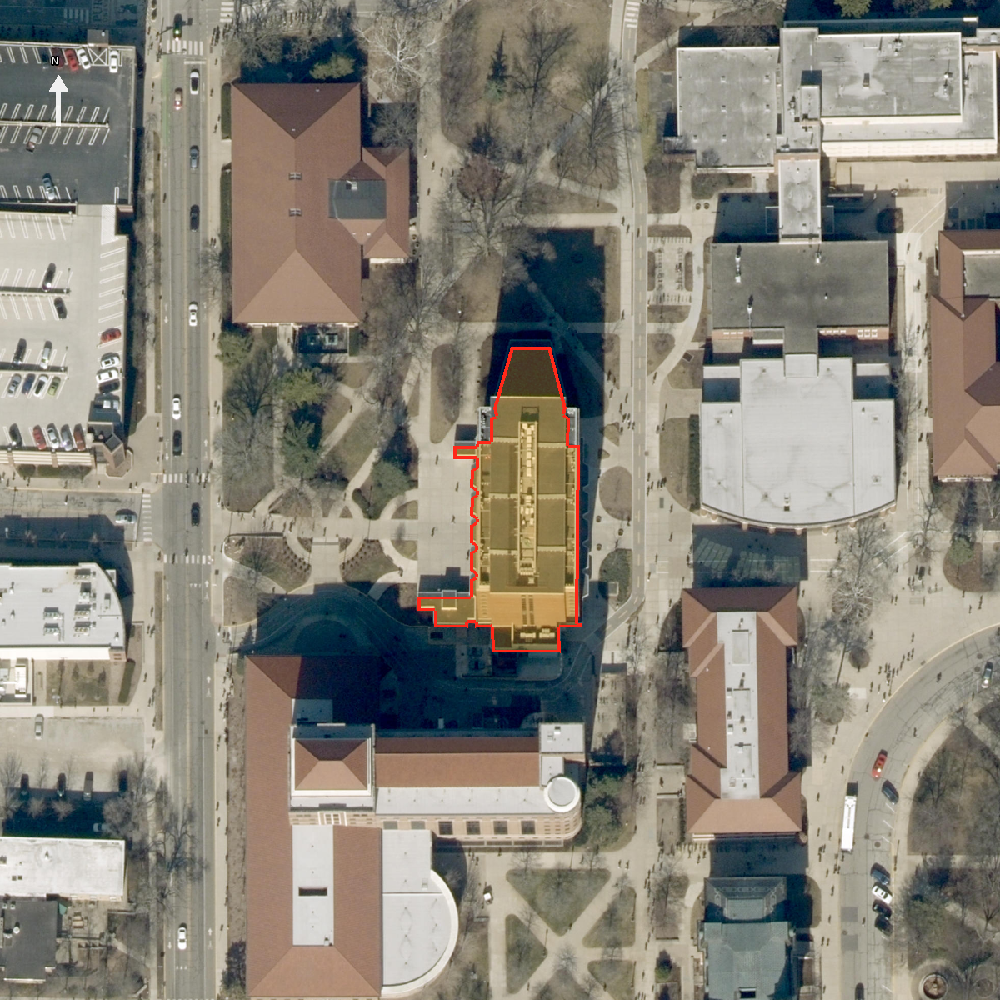

# Math Sciences — exterior research

**Second-pass rank:** 30 · **stable ID:** `math_sciences` · **asset owner:** Rossen  
**Asset:** `modular/buildings/math_sciences.blend` (not opened or edited)  
**Official identity:** Mathematical Sciences Building (MATH), 150 N University Street, West Lafayette, IN 47907  
**Purdue GIS feature:** FID 227 · **research review date:** 2026-10-30  
**Pass status:** Prepared with gaps. Exterior identity, footprint, principal architectural vocabulary, roof silhouette and one current ground-floor change are documented. The available sources do not support a complete cardinal-face/floor opening schedule, elevation set, or measured roof height, so this package is not a model-ready elevation brief.

## Identity, condition date, and footprint

The assigned asset matches Purdue GIS FID 227, `Mathematical Sciences Building`, abbreviation `MATH`, address 150 N University Street. Purdue's Math department identifies the building as housing Mathematics, Statistics, College of Science Administration and Purdue IT ([building page](https://www.math.purdue.edu/about/building)). The Archives corporate-entity record describes a 10-story structure for Mathematics, Science administration and Computer Sciences; the catalog describes historic purpose, not the present tenant list ([Archives record](https://archives.lib.purdue.edu/agents/corporate_entities/672)). Purdue's historical timeline records the Math department's move into the new Math Building in 1967 ([timeline](https://collections.lib.purdue.edu/timelines/puhistorical)). Treat 1967 as the documented opening/occupation context; exact construction and dedication dates were not resolved here.

The live Purdue GIS query for FID 227 is retained in `sources/purdue_footprint_live_2026-10-30.geojson`; it returns one polygon with a single closed ring, 50 intermediate vertices, no second feature or inner ring. It matches the inherited 2026-10-28 location snapshot exactly in EPSG:26916 (IoU 1.0; Hausdorff distance 0 m). The snapshot copy is retained separately as `sources/purdue_footprint.json`. In a local UTM Zone 16N projection (EPSG:26916; coordinates in metres), the ring area is **1,440.22 m²**, perimeter **218.56 m**, and axis-aligned envelope **36.70 × 67.73 m**. Its minimum rotated rectangle is **36.70 × 67.74 m** and is aligned almost exactly east–west/north–south. The long body runs north–south; the 50-point perimeter contains local steps/recesses and short westward projections, so replace it with neither a plain rectangle nor a smoothed footprint. The GIS feature's `Shape__Area` (2489.98) and `Shape__Length` (287.50) do not agree with the ring-derived projected area/perimeter; their units/derivation are undocumented and they are not used as dimensions. The overlay is a coordinate transform of that GIS ring onto the retained north-up World Imagery export; it is for locating the footprint, not a survey.

The aerial export shows a flat-roofed, tall north–south body with a narrower central roof run/equipment strip, flanking roof fields, and stepped south and west outline details. Trees, shadows and adjacent roofs occlude parts. The imagery export and aerial source do not expose a verified capture date. Retrieval on 2026-10-30 is not a capture date. No imagery acquisition date, camera location, bearing or ground-level viewpoint is assigned. The overlay has north at the top; cardinal orientation can be used for footprint/roof plan only.

MATH sits in a dense central-campus pedestrian setting. Purdue Admissions' daily-tour page warns of windy conditions at the Math Building land bridge, supporting a passage below/through the building but not its exact opening, height, construction, or façade position ([tour page](https://ontour.admissions.purdue.edu/daily-visits/)). The GIS ring includes small connecting/step-like projections; the exact physical boundary between building, bridge, dock and attached canopy is not recoverable from the aerial alone. MATH's facilities contact is listed at `MATH 199 (West Dock)` ([Math department building page](https://www.math.purdue.edu/about/building)); this establishes a named west dock location, not the dimensions or appearance of its door/approach.

## Reference condition and renovation

Use the documented historic tower as the base architectural phase and flag the ground-floor data-center frontage for a current-condition check. A Purdue Board of Trustees project brief dated 2024-07-23 approved renovation of almost 21,000 gross square feet on the ground and basement floors. It says the data center would expand east into existing office space and install a glass window in the new east wall, with construction planned for May 2025–February 2026 ([BOT project brief](https://www.purdue.edu/bot/meetings/past-meetings/2024/06.%20aug/pfc/MATH%20Data%20Center.pdf)). RCAC's 2026-08-05 progress post says the project was in its final stages, refers to a new showcase window, and publishes a progress photo ([RCAC progress report](https://db.rcac.purdue.edu/news/7787); image retained as `sources/math_dc_showcase_window_progress_2026-08.png`). The photo is an interior view looking through the glass at servers, not an exterior view or elevation. This establishes a recent east-wall ground-level glazed display as the intended/current design, but not its outside frame profile, exact bay, sill/head, or completed condition at this review date. Keep the ground-floor east elevation flagged for field/photo confirmation. No exterior addition or changed tower massing is evidenced by the reviewed renovation sources.

## Walk-around evidence and face/floor opening schedule

No inspected image has a documented camera position/bearing. In the tables, “A” means a visible face in Purdue Archives image 823; “B” means the principal face in its design illustration 824; “C” means the small official Statistics-department photo; none can be tied to a compass direction. Image 823 is a datedness-unknown archival exterior photograph, black-and-white, cataloged as 12 × 10 cm. Image 824 is an undated archival perspective illustration, not an as-built record, cataloged as 10 × 12 cm. Both originals are retained. Photo C is a small official department image (196 × 258 px), capture date unknown. John Feister's Flickr image is a high-resolution, owner-dated view from 2009-09-26; the original is **not** retained because Flickr states all rights reserved. Its page/rights/date are recorded at [Flickr](https://www.flickr.com/photos/ataindy/4062109632/); prior inspection found one broad facade, a side return, a parapet/raised edge and tree-obscured base, but no GPS or bearing.

| Face / evidence | What can be laid out from the inspected source | Floor-specific schedule and limits |
| --- | --- | --- |
| Broad photographed elevation A (compass unknown) | Tall masonry tower over a lighter base; repeated narrow vertical glazed/window strips divide the broad wall into regular vertical groups. Simple end/corner bays interrupt the repeated field. Parapet/raised roof edge visible. | Repeated vertical pattern is confirmed, but image resolution and perspective do not support reliable bay totals, individual sash divisions, widths, floor-by-floor openings, reveals or infilled bays. Do not project its pattern onto another face. |
| End/return elevation A (compass unknown) | One largely blank masonry end wall has a sparse vertical stack of small square/rectangular openings; adjacent long wall is window-rich. The photo demonstrates that adjacent faces differ. | The opening stack is visible qualitatively only; exact count/levels and which cardinal end are unknown. The opposite end is unobserved. |
| Principal illustrated elevation B (compass unknown; design view) | Repeated vertical window bands across the central field, simpler corner/end bays with small openings, a glazed/light lower level, and a flat parapet with a raised roof element behind it. | Illustration records design intent only. It is not accepted as proof of current/as-built bay count, sash pattern, roof equipment or current façade. |
| Official photo C (compass unknown) | Small color view supports red/brown brick appearance, grouped vertical windows, simpler end bays, and a pale/glazed lower entrance zone; tree canopy blocks the base. | No reliable floor schedule or date. Image file retained; the small source image is not dimensionally useful. |
| **East (GIS-oriented)** | A 2024 Purdue project brief specifies new ground-floor glazing on the expanded east data-center wall; 2026 RCAC progress confirms a new showcase window and its interior view. | Ground-floor glazing is a documented recent change, but precise exterior opening dimensions/profile and completed condition are unverified. All upper floors unknown. |
| **West (GIS-oriented)** | West Dock is an official named building location; no inspected photo maps a face to the dock or shows its openings. | Door, dock/bridge relationship, all floor openings and upper-floor pattern unknown. |
| **North (GIS-oriented)** | No compass-registered elevation photo or elevation drawing inspected. | All openings, blank zones, entrance, corner returns and floor schedule unknown. |
| **South (GIS-oriented)** | No compass-registered elevation photo or elevation drawing inspected. A photo shows a lighter lower zone and entrance-like area on an unlocated face. | Cannot assign entrance, steps/ramps or photographed blank end to south. All floors unknown. |

No opening totals are inferred by symmetry. The broad repeated vertical strips, simpler end bays, pale glazed base and one blank end are observed motifs, not four-face schedules. The distinct passage/land-bridge is not incorporated into the tower opening schedule because no source provides its exact face position or section.

## Massing, signature details, roof, and materials

The archival photograph and illustration agree on a rectilinear, approximately ten-story tower over a visually distinct lower level. The historical photo shows one blank end and a window-rich long face, so the tower is not a uniform curtain-wall box. The lower storey reads lighter and more open than the dark upper wall. The render/illustration suggests a simple parapet and a slightly raised roof piece behind it. The registered aerial shows a central north–south rooftop run, flanking roof surfaces, localized mechanical clutter and a stepped footprint, but neither roof objects' function nor height can be established from an uncalibrated overhead image.

No reliable evidence establishes entrance column/canopy profiles, plinth projection, base glazing mullions, loading/dock door design, bridge support section, parapet coping, rooftop penthouse dimensions or equipment identity. The light strip at the foot of the photographed tower could combine glazing and opaque base materials; do not infer full-height curtain wall. Purdue Statistics' photo and the aerial indicate red/brown masonry, while black-and-white archives only establish a dark masonry appearance. Brick type, mortar, stone/concrete panel areas, metal/glass specifications, calibrated color values and finish are unverified. Purdue's 2024/2026 data-center sources document the new interior showcase window but no exterior frame/material specification.

## Plan and vertical constraints

The GIS ring is the defensible horizontal constraint. For reproducibility: the retained ring is EPSG:4326, transformed with pyproj to EPSG:26916 (NAD83 / UTM zone 16N, metres); calculations use the closed polygon without rounding. Resulting bounds are E 507120.584–507157.281 m, N 4475038.801–4475106.535 m. Compare against the source geometry, not the undocumented GIS shape summary fields.

The retained Indiana QL2 point-cloud crop is tile `in2018_29951885_12`, acquisition 2018-04-20. It contains 26,461 returns (class 1: 14,461; class 2 ground: 11,978; class 7: 22), with 7,058 returns inside the GIS footprint. Source/clip CRS is compound NAD83(HARN) / Indiana West (ftUS) + NAVD88 height (Geoid12B, ftUS); vertical and horizontal feet use factor 0.304800609601219 m/ft. The median ground return outside the footprint is 623.54 ftUS NAVD88. Within an eroded footprint, 5,719 class-1 returns have relative-height p50/p90/p99 of 37.01/37.75/40.52 m above that local median. These are mixed class-1 returns, not a fitted roof surface: trees, equipment and edge spill remain, so none is an eave, roof slab, penthouse or parapet height. The 2018 survey also predates the data-center renovation.

Height evidence conflicts: Purdue Archives describes the building as 10 stories; the GIS attributes carry `NUM_LEVELS=12` and `CountOfFLO=12`, while the same record has undocumented `Extrution=132`, `F01`–`F10` values 28–134.2, and `R=147.7`. Those fields' units, reference datum, semantics and update date are not documented in the retained response. They cannot be treated as measured metres or feet. The 2024 board project and 2026 progress report establish interior ground/basement construction, not a change to above-grade tower height. No surveyed elevation, section, current roof point classification, verified floor-to-floor height, parapet datum or roof-object height was found.

## Source register and reproducibility

`source_register.json` lists retained byte-level sources, SHA-256 hashes and direct provider URLs, including the live GIS query and the retained archive/dept/renovation sources. `sources/site_download_index.json` records collector retrieval URLs/times/hashes for the live GIS footprint, aerial export and lidar tile metadata. `sources/aerial_world_imagery.png` is the unaltered image; `sources/aerial_footprint_overlay.png` is a derived north-up overlay. The two Purdue eArchives source images remain under their cataloged Purdue Libraries copyright notice; their catalog item and IIIF URLs are in the register. The official Statistics photo is retained with its source page. The Flickr original is not copied into this package; rely only on the linked public page metadata and prior visual inspection noted above. The retained LiDAR clip is a full-resolution spatial query of the specified provider tile, not a derived mesh or building surface.

## Builder brief and unresolved research

For a later modeling pass, use the GIS ring unchanged for plan placement and preserve its west-side/south-side steps. Start the shell as a tall north–south rectilinear tower with the photographed dark masonry upper mass, differentiated light/open lower level, a pronounced broad-face rhythm of repeated vertical glazed bands, and simpler small-window end bays. Keep the known blank end separate from the window-rich side but leave its direction unknown. Add no exact bay counts, floor openings, dock/bridge section, parapet height or rooftop equipment dimensions from this dossier. Retain a simple flat parapet/raised roof silhouette only as a qualitative historic cue. Flag east ground-floor showcase glazing for the post-renovation state and verify its exterior appearance. Any specific face mapping, individual opening run, dimensions or material finish requires new evidence.

**Concrete unresolved items:**

1. Cardinal direction mapping for archive photos 823/824, the Statistics photo and the 2009 Flickr oblique; current face-by-face ground views of all four elevations.
2. Full face × floor opening schedule: exact bay counts, window/door type, sash/mullion divisions, sill/head levels, blank/infilled/service areas, corners and recesses; opposite end elevation is especially undocumented.
3. Exterior elevation and section drawings or survey tying grade, ground/basement, 10-story archive description and 12-level GIS fields to a common datum and defining tower/eave/parapet/penthouse elevations.
4. Roof plan and measured roof elements; identify the long central rooftop run, side roof fields, penthouse, HVAC and small fixtures using dated overhead or access photographs.
5. Entrance, West Dock, land-bridge/wind-tunnel passage, stairs/ramps, canopy, base glazing and exact attachment/ownership boundaries; source a section or face-specific photo.
6. Exterior material specifications and calibrated color references; identify brick/panel/glazing/metal and any later façade repairs.
7. Confirm the east-wall showcase window's final exterior size, mullion/frame, location within the east elevation and completed status after the 2026 renovation.
8. Establish World Imagery scene acquisition date and obtain recent camera-positioned, face-specific current photographs. The current export's retrieval timestamp is not imagery date evidence.
9. Reconcile the shape summary area/length and vertical GIS fields with a documented unit/version history; preserve the ring-derived measurements pending that reconciliation.
10. Pursue original elevation/roof/floor drawings and the physical archive lead for Mathematics Library floor plans; no complete current as-built plan or exterior elevation was inspected.

This package records the strongest available source-backed exterior constraints while retaining these gaps. No geometry, model, manifest, placement, master asset or builder file has been changed.
