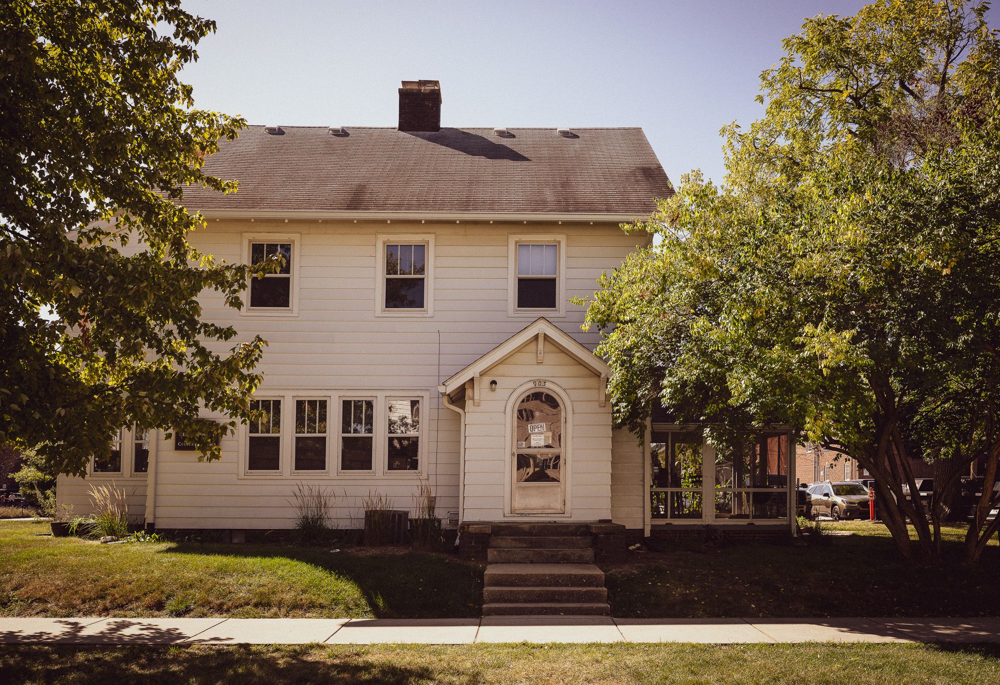
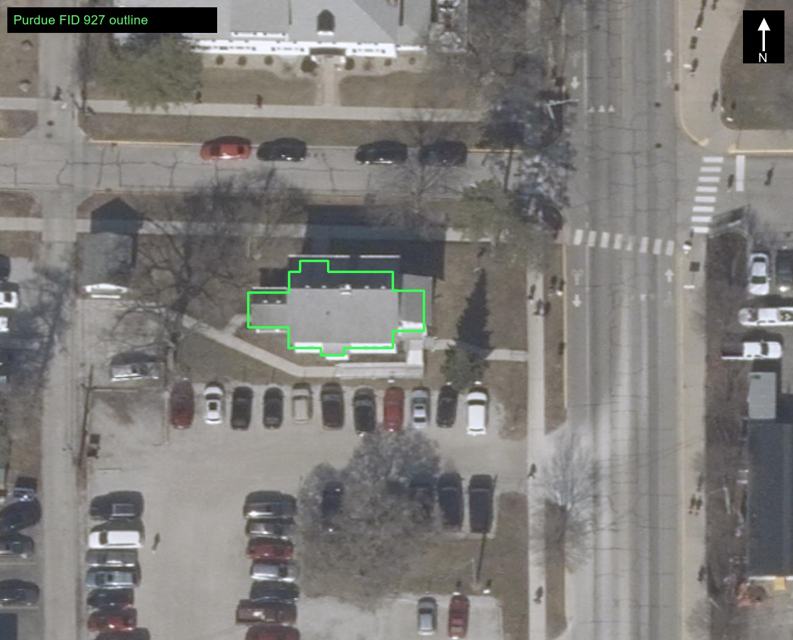

# Native American Educational and Cultural Center — second-pass exterior research

**Queue rank:** 48 · **Stable ID:** `native_american_educational_and_cultural_center_nacc` · **Model owner:** Rossen
**Current use:** Native American Educational and Cultural Center (NAECC); Purdue emergency records use “NACC.”
**Review date:** 2026-10-30 · **Status:** Exterior research package prepared with substantial all-face, height, opening, material and detached-garage gaps retained; provisional, not build-ready.

## Identity, property, orientation, and chronology

Purdue’s March 17, 2026 Building Emergency Plan identifies 903 Fifth Street as the Native American Educational and Cultural Center, a self-contained former single-family, two-story wood-frame house with a basement. It places the building at the corner of Fifth and University streets, says the main/front door faces Fifth Street, identifies a second front door facing the large gravel parking lot as the accessible entry with a ramp, and locates the rear kitchen door on the alley. The plan says the Asian American and Asian Resource and Cultural Center (AAARCC, 915 Fifth Street) is directly behind NACC across the alley. A single-car garage stands in the rear yard and is used for storage; the plan does not state its exact footprint or setback (E1).

The 2023 Purdue for Life “A Window Into Westwood Manor” story states that the Stewarts lived at **903 North Fifth Street** before building Westwood, and explicitly identifies that address as the present NAECC. This ties the current site to an earlier residential use; it does **not** give this house’s construction date or prove that all visible current fabric is original. Purdue’s institutional timeline says the Native American Cultural Center was established in 2007 and moved to its Fifth Street location in 2016 (H1–H2). Current official home-page text confirms the name and address but supplies no elevation or construction date (E2).

Purdue BuildingShapes feature FID 927 identifies the NACC at 903 Fifth Street. The cached WGS84 ring has 20 vertices; the local project transform yields bounds of approximately **16.215 m × 11.576 m** (E3–E5). The official 2023 orthophoto overlay shows the small house in context with streets, adjacent parking and neighboring structures. The polygon is a map footprint, not a surveyed foundation/wall line. The aerial crop and footprint are kept in the image service’s exact returned WGS84 extent without fitting the outline to roof edges. A detached single-car garage is described by Purdue but is outside this FID927 building ring; whether a later asset assignment includes that auxiliary structure is a scope question to resolve from the project’s stable asset definition, not from the lot photo alone.

## Inspected views and coverage

| ID | Source/view | Exterior evidence actually visible | Date / camera / limits |
|---|---|---|---|
| **P1** | Purdue for Life’s Westwood story image, `purdueforlife_903_north_fifth_exterior.jpg`, 2048×1404. The page caption identifies 903 North Fifth as the Stewarts’ former home and today’s NAECC. | Broad, near-frontal view of a white, horizontally sided two-story residence; shallow, dark-shingled roof with a tall chimney; three upper-level front windows; a ground-level cluster/bank of windows; projecting small front gable/porch around an arched glazed door with house number 903; broad entry steps; and a low glazed volume beside the porch. Also shows exposed base/foundation, eaves, gutters/downspout, and current campus signage/planting. | Story page retrieved 2026-10-30; exact photo capture date and camera station/height are not stated; the page’s “wi23” slug suggests a winter-2023 issue but is not treated as a verified image date. Trees obscure the left window run and shade the base; the warm exposure is not a calibrated material sample. |
| **P2** | Google Maps Street View panorama thumbnail, pano ID `4_SDyC6fUfc_Ve3mZmzt_g`, 408×240, retained from the visible 903 Fifth map page. | Near-front street view of the white two-story house, main door/entry gable, upper windows, lower windows and a limited view of one adjoining side. Confirms the residential silhouette and broad appearance independently of the Purdue for Life image. | Google map page identified the address and “Street View”; capture date and station coordinates were not exposed. The pano viewer itself rendered black in this browser session, so only the visible thumbnail was inspected. Low resolution, trees and perspective prevent a complete elevation schedule. |
| **A1** | Indiana 2023 ImageServer north-up orthophoto and official FID927 outline overlay. | Shows the roof plan and parcel context: one small compact house footprint, street corner, parking area and nearby buildings. Supports the compact, detached-house massing and general site access relationships; a distinct detached garage is not confidently isolated in this crop. | Exact flight day unavailable in export response. Resolution, tree shadow and roof edge setback obscure walls, porch depth and small equipment. |
| **E1** | Purdue Office of Emergency Preparedness BEP, revision 2026-03-17; full accessible HTML snapshot retained. | Written identification and orientation for the front door, gravel-lot accessible door/ramp, rear kitchen/alley door, back porch, 2-story/basement configuration and detached storage garage. Room 110 is named “Back Porch.” | Not an architectural drawing or photo. It gives no wall dimensions, window positions, ramp plan/section, porch dimensions or garage setting-out. |
| **H1** | Purdue for Life Westwood story page and its captioned 903 Fifth image. | Address continuity for the former Stewart residence and the current NAECC, plus visual evidence of the present-looking house. | No construction date or full house history is stated. The story’s other historical photos depict Westwood/the Stewarts and are not used as photographs of the 903 Fifth house. |
| **R1** | Prior NACC audit/grade package in `audit/build_nacc/`. | Reports a two-story-plus-basement shell, GIS plan match and model-estimated roof/eave heights. Useful only for recording current project assumptions and source gaps. | Model/render measurements are not building truth. The previous audit itself says roof pitch, eaves/ridge, window rhythm, porch and ramp dimensions were not verified by measured elevations/current facade photography. No model was opened or changed for this pass. |

The P1 image shows substantially more detail than a generic “white house” description: the upper front has three separated, white-trimmed rectangular sash windows; the ground floor has a smaller, tree-obscured left run and a larger contiguous bank of tall windows; a shallow projecting entry gable interrupts that ground-floor sequence; and a glass-sided low addition/vestibule continues at the photographed right. This is a source-relative schedule for the visible face only. The image is not cardinally registered; the official plan identifies the front door as Fifth-facing, which is the best available face label for this entrance, but does not georeference the photo station.

## Face and opening schedule

Count directions below are tied to the visible image edges, not an assumed north/east/south/west heading. The only confirmed cardinal link is the official statement that the main/front door faces Fifth Street (E1).

| Face/run, from left to right in P1 | Observed openings and architectural sequence | Confidence / unknowns |
|---|---|---|
| **Fifth-facing front at the main door** | Upper story: three separate rectangular window openings, regularly spaced across the visible wall. Each has light trim and appears to have a divided upper sash over a larger lower sash; reflections/resolution make muntin count uncertain. Main floor: two smaller/partly tree-obscured openings at the image-left end, followed by a visibly wider bank of about four tall adjoining sash openings; a small gabled projecting porch/entry with arched glazed door and the house number breaks the run. A shallow set of broad steps rises to the entry platform. | Three upper openings and the porch/door are clear; the left lower count is partly hidden and the boundary/continuity of the four-window bank is uncertain. Do not assert exact sash pane counts or construction size. No elevation drawing, dimensions or face-normal photograph with scale. |
| **Front/parking-lot accessible entrance (E1)** | Official BEP identifies a third main-floor exit at the front of the house facing the large gravel lot and says it is the only accessible entry, with ramp. P1 shows a low glazed extension adjacent to the photographed porch, which may be associated with this route. | The route’s door, ramp, landing, slope, rails, retaining/grade conditions and relation to the low glass volume are not tied together by a plan or georeferenced photo. Treat the connection as a hypothesis pending direct confirmation. |
| **Rear kitchen/alley elevation (E1)** | Rear door immediately off the kitchen faces the alley. Room list separately names Room 110 “Back Porch.” | No direct exterior photo or plan showing the door, porch depth, roof/columns, windows or wall length. Exact door bay, porch attachment and alley-facing opening schedule unknown. |
| **Remaining side elevation and corners** | GIS/A1 establish overall small-house footprint; P2 shows only a foreshortened side sliver. | No registered near-normal view, hidden corner or full window/door count. Do not mirror the front windows across either side. |
| **Detached garage and yard** | BEP states a single-car detached storage garage behind the house. | A1’s small crop does not confidently separate garage from nearby/adjacent structures; no source gives dimensions, position, roof, openings or current condition. Whether to include it in this building asset is unresolved. |

No complete walk-around is available in the retained sources. I checked the first-party Purdue page, its related campus video-tour page, the address’s Google Street View entry, the 2023 orthophoto, the OEP plan and the Westwood historical article. Only P1 and the low-resolution P2 expose the house exterior, and both primarily show the front. This is insufficient to claim all-face exterior coverage. The documented address and door orientations still give a future survey a reliable route plan: Fifth-facing main living-room entrance; separate parking-lot accessible entrance; alley-facing kitchen/back-porch door.

## Roof, massing, details, and materials

- **Primary shell:** treat it as a freestanding former residence rather than a purpose-built institutional block: two stories above a basement per current Purdue OEP record. The only known public footprint is compact and irregular (about 16.2 × 11.6 m extents). The GIS one-level field conflicts with the written BEP and should not replace its explicit story description (E1, E3–E5).
- **Roof silhouette:** P1 shows a dark shingle-covered low-pitch roof with a long main ridge/hip-like outline and a single tall rectangular chimney rising near the middle of the visible roof plane. P2 is broadly consistent. The exact hip/gable/end treatment, pitch, ridge direction, eave height, chimney section/material and roof edge cannot be established from the hidden ends and low-res street view. The prior modeled gable roof is an estimate and may conflict with the broad hipped-looking front silhouette; do not preserve it as verified source fact.
- **Entry composition:** the public front door sits in a small projecting gabled porch with simple light-painted framing/brackets, a shallow gable fascia, arched glazed door and house number. Broad straight steps lead from grade to a raised landing. No dimensioned front entry section is available. The official accessible ramp belongs to another front exit facing the parking lot; its geometry remains unknown.
- **Side glass volume:** P1 shows a low, mostly glazed projection at camera-right, with dark frames and a low roof. It may serve the accessible entry identified in E1, but no source labels this photo feature or establishes its plan connection. Keep that association uncertain.
- **Exterior materials:** P1 shows white horizontal lap-like siding and light trim, dark gray/brown shingles, a dark chimney, shaded exposed base, and clear/dark reflective glazing. Purdue describes the structural house as wood frame. Current cladding itself is not specified; do not claim original painted wood or modern vinyl. Color is photographic, affected by warm light and shade, and is not calibrated. Trees, lawn, street sign, shrubs, planter, center signage and temporary window notices are not fixed wall geometry.
- **Current alteration evidence:** the P1 ground floor has a long bank of closely spaced windows and an adjoining glazed projection that differ in scale from the three upper separated windows. No alteration date or preservation record was located, so do not attribute these changes to the 2016 cultural-center conversion. The former house use, NACC occupancy and present visible state must remain distinct in the record.

## Evidence-led brief and existing-asset discrepancy checklist

A future exterior asset should begin with the official small-house footprint and retain its jogs only as a GIS plan constraint until a field-checked foundation outline is available. The source-backed face should preserve a two-story white-sided residential mass over a basement, broad low dark-shingle roof, chimney, three separated upper front sash windows, a larger uneven ground-floor group, and a small arched-door gabled porch with broad steps. The side accessible entrance, rear kitchen exit/back porch, other elevations and garage must remain unscheduled until directly observed or plan-documented. Do not substitute an institutional facade, a symmetric window pattern, a speculative Tudor/gable style, or an unsupported roof pitch for missing evidence.

The previous R3 audit describes a footprint-matched model with two stories plus basement, a modeled gabled roof, estimated eaves/ridge, three doors and a modest covered rear porch. The current first-party exterior and official BEP are independent real-building evidence that can refine those assumptions: they support the front porch and front-door treatment, materially constrain the front-window rhythm, favor a broad low-pitch hip-like roof silhouette over an unqualified gable, and verify distinct public-front, parking-access and rear-alley doors. The R3 exact match to FID927 only establishes correspondence to the map ring. It does not verify roof profile, heights, window runs, ramp, porch dimensions or garage placement. The NACC work package’s owner remains Rossen; no asset, builder, placement, collection or master-scene edits occurred.

## Specific gaps and evidence needed

| Gap / affected area | What was checked; why it remains open | Evidence that would resolve it | Exterior impact |
|---|---|---|---|
| **All-face registered walkaround** | First-party image P1 and Google panorama P2 are front-dominant; P2 is small and undated. A1 is only top-down. | Current daytime near-normal views with mapped camera stations on Fifth, University, parking-lot/front side and alley; overlapping corner views tied to FID927. | Three facades and corner transitions cannot be scheduled or modeled without invention. |
| **Front wall lower openings and exact windows** | P1 tree hides the left lower wall; sash divisions are small in the source and glass reflections obscure detail. | Clear front-on daytime photograph or measured elevation/window schedule, close-ups with scale. | Bay count, lower-run spacing, muntins, frame depth and sash type remain approximate. |
| **Parking-lot accessible entrance / ramp** | E1 locates a ramp and accessible door, but P1’s glass-side projection is not registered to that door; no side view or access drawing. | Accessible-route/as-built plan, current entrance photo, frontal/side ramp views and dimensions. | Ramp/landing/rail, wall openings and grade transition are substantial missing geometry. |
| **Rear kitchen door and Back Porch** | E1 confirms alley door and room 110 “Back Porch”; no exterior side view or drawing. | Alley-side photo walkaround and plan/section of porch, door and wall. | Roof/support/depth, rear openings and attached versus open porch remain unknown. |
| **Other full side, corners and service features** | No near-normal exterior views; tree/neighboring buildings in P1/P2 obscure limits; A1 cannot resolve doors/windows. | Dated camera-mapped corner walkaround, utility records or house elevations. | Hidden windows, vents, service entries, downspouts and corner trim are not established. |
| **Roof form and vertical measurements** | P1 provides silhouette and shingle appearance only; no survey heights, pitch, roof plan or vertical datum. GIS `NUM_LEVELS=1` conflicts with BEP’s two-story/basement description. | Measured elevations/sections/roof plan, roof oblique, or well-documented classified LiDAR with ground tie and vertical datum. | Eaves/ridge/chimney height, pitch, hip/ridge direction, basement exposure and story lines remain uncertain. |
| **Detached storage garage** | E1 states a single-car garage behind the NACC; location/dimensions/roof/openings are unspecified and not isolated in A1. | Parcel/as-built plan, close and overhead views, clear asset-scope instruction. | Auxiliary structure can be omitted, misplaced or absorbed into the main shell without evidence. |
| **Construction and residential alterations** | H1 ties the address to a previous Stewart home before 1932 but does not date the house; P1 has no capture date or alteration history. | Tippecanoe County assessor/permit records, historic Sanborn/insurance map, Purdue Archives photo or property file, original plans and dated conversion drawings. | Current front glass bank, porch, siding and roof cannot be assigned to original house or 2016 conversion phases. |
| **Material identity and present condition** | P1 shows apparent white lap siding/shingles; OEP says wood frame, not cladding. No source specifies paint, wood/vinyl, mortar/foundation finish, roofing product or trim profile. | Close daylight material photos and maintenance/product/contractor records. | Color, lap depth, trim profile, roof texture and exposed base can only be estimated. |

## Provenance and retained sources

The [source register](sources/source_register.json) records 10 source records, capture/retrieval basis, local snapshots, SHA-256 hashes and limitations. It retains the official OEP HTML, current NAECC home page, Purdue for Life Westwood article and its full first-party 903 exterior image, the Google Street View thumbnail surfaced on the visible address page, the current Purdue GIS feature and layer metadata, the earlier cached feature, and the Indiana 2023 orthophoto request/response/crop/overlay. Full street-view panorama rendering was attempted in the browser; its canvas stayed black, so the low-resolution loaded thumbnail is the only Google imagery used. Related Purdue video-tour imagery was inspected and found to be an interior interview still; it was excluded from the exterior evidence package.

Research only; no modeling or geometry edits were made.
