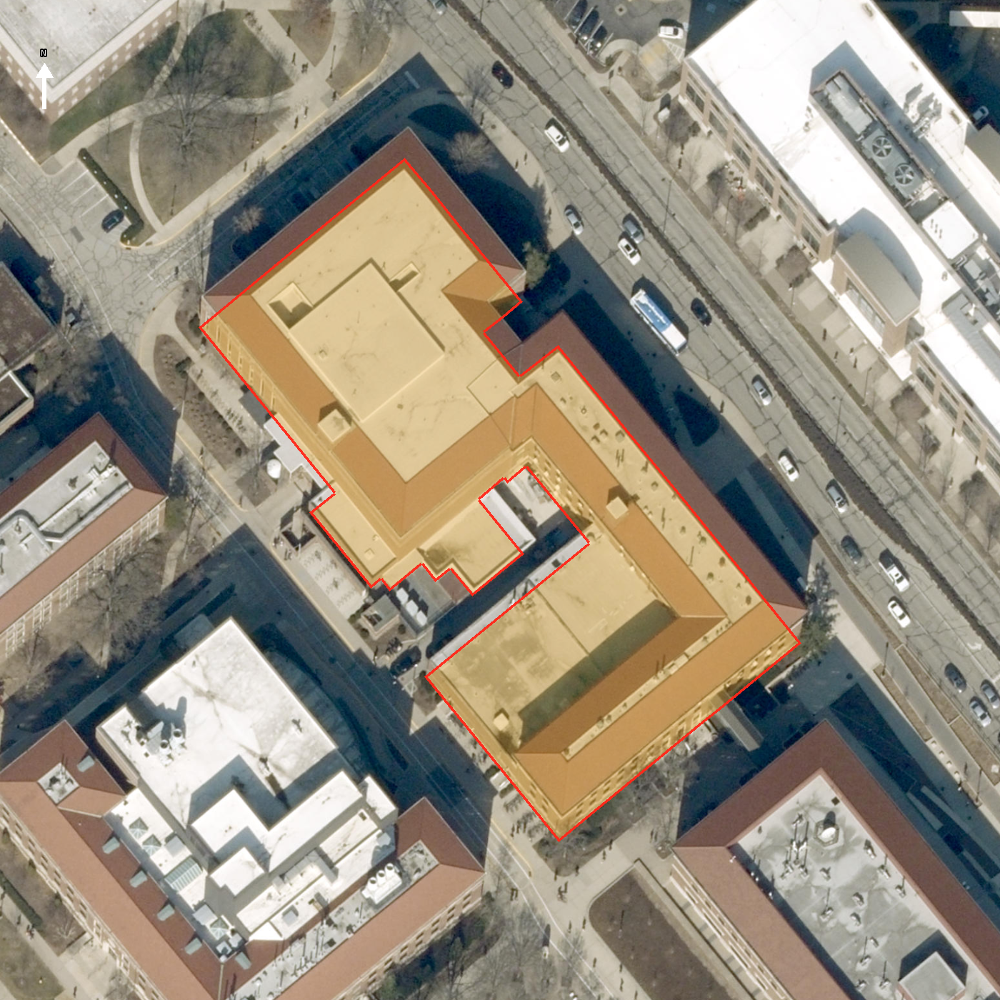

# Physics Building — exterior research

**Second-pass rank:** 31 · **stable ID:** `physics_building` · **asset owner:** Rossen
**Asset:** `modular/buildings/physics_building_phys_3bf42f3.blend` (not opened or edited)
**Identity:** Physics Building (PHYS), 525 Northwestern Avenue, West Lafayette, Indiana · Purdue GIS FID 273
**Review date:** 2026-10-30
**Pass status:** Prepared with gaps. The live footprint, multi-wing plan, a source-counted main elevation, the entrance composition, roof families and construction phases are documented. Full current coverage of the court/back face and both ends, exact measured elevations and complete face/floor schedules remain unavailable; this package is provisional, not model-ready survey data.

## Identity and architectural phases

The live Purdue University GIS record identifies FID 273 as `Physics Building`, abbreviation PHYS, at 525 Northwestern Avenue. The stable ID and Rossen-owned modular asset match that official record. Purdue Physics says the department occupies the Physics Building, originally the Charles Benedict Stuart Laboratory for Applied Physics, and an attached two-story subterranean laboratory complex. The underground facility is a connection/program note; the inspected GIS and aerial do not establish its complete extent or a visible above-ground mass. The GIS record is one exterior ring, not proof that every below-grade department facility lies within it.

The chronology is phased and sources disagree on the initial year. Purdue Physics's history says two additions were made to the old Physics Building in 1934 and 1937, followed by a new building constructed and ready for occupancy in August 1941; that older section is today's Northwestern Avenue building's “older section.” The building was dedicated in 1942 as the Charles Benedict Stuart Laboratory for Applied Physics. Purdue's campus timeline lists the Physics Building as completed in 1940. For this brief, use the department history's specific completion/occupancy account (1941), keep 1940 as a conflicting campus-timeline date, and retain 1942 as the separate dedication date. A 1960 Purdue Alumnus index result announces a planned three-story addition; its as-built outcome and relationship to the current wings were not established. The exact present-day boundary between the original section and later additions remains unresolved.

An important source exclusion was made during inspection: the dramatic night image `registrar.jpg`, previously described in the inherited audit as a Physics entrance, is embedded in the Physics department's Campus Resources page as the image for the Office of the Registrar link (`sources/campus_resources.html`, source URL in the register). That page provides no evidence that the pictured building is Physics. It is excluded from all building observations and must not be used to model an arched Physics entrance without independent identification.

## Live footprint, orientation, and campus connections

The live FID 273 query is retained as `sources/purdue_footprint_live_2026-10-30.geojson`. It has a single 33-vertex exterior ring (34 coordinate pairs including closure), with no holes or other features. It matches the inherited 2026-10-24 GIS snapshot exactly after projection to EPSG:26916 (intersection-over-union 1.0; Hausdorff distance 0 m). Reproducible ring-derived plan constraints in NAD83 / UTM zone 16N, metres:

- Area **5,157.61 m²**; perimeter **441.44 m**.
- Axis-aligned envelope **106.19 × 120.12 m**.
- Minimum rotated rectangle **110.31 × 55.16 m**, with its long axis at approximately **140.73° / 320.73°** (SE–NW) from north.
- UTM envelope: E **507287.755–507393.943 m**, N **4475439.937–4475560.060 m**; centroid E **507340.336 m**, N **4475500.151 m**.

Purdue GIS reports `Shape__Area=8918.0078` and `Shape__Length=580.5009`. These are service-plane Web Mercator summaries; at the footprint latitude, the area scale correction (`cos(latitude)²`) yields about 5,167 m², close to the UTM ring result. Use the projected vertex calculation above for dimensions; do not treat raw summary values as square or linear metres. The inherited asset audit's project-local area (5,158.85 m²) differs slightly from EPSG:26916 due to its local equirectangular transform; the source boundary itself is unchanged.

The north-up roof view and outline show a large, irregular connected, multi-wing complex rather than one bar-shaped block: its outer envelope is diagonal NW–SE, with a deep stepped court/notch and several joined roof masses. Red/brown sloped tile roof strips and hips wrap around broader light/flat roof fields; the roof also carries scattered mechanical units and penetrations. The image does not distinguish courtyard paving from low roof in every area and cannot identify roof equipment, parapet height or the exact above-grade wall footprint. The imagery provider export was retrieved 2026-10-30; its actual acquisition/scene date is unknown. No camera position, bearing or elevation is available from this overhead source.

The principal photograph is likely the northeast, Northwestern Avenue-facing long elevation: it is a nearly frontal street-side photograph with roadway and sidewalk in the foreground, and the official address is on Northwestern Avenue. The site alignment and the image support this interpretation, but neither image has GPS or camera azimuth. Treat the northeast mapping as a reasoned orientation inference, not a surveyed camera registration. The primary photo's frontal view covers most of a long, symmetrical-looking wall; the Purdue Events view is a 2022-posted oblique showing that frontage continuing around a corner and a partial side return. It also shows a glazed pedestrian connector near one end. The department identifies a two-story subterranean laboratory complex, while the photo and location context show a skybridge relationship toward neighboring MSEE; neither source fixes its endpoints, exact face, span or ownership. The bridge must remain distinct from PHYS's one-ring footprint until as-built drawings resolve its attachment.

## Source-keyed walk-around and opening schedule

No photographic source in this package supplies EXIF camera GPS or a compass bearing. Dates below are capture dates only when the source explicitly provides them; page/post dates are not silently treated as capture dates.

| Source / viewpoint | Inspected exterior evidence | Coverage and limitations |
| --- | --- | --- |
| **P1 — Purdue Physics/Xia contact photo**, retained original at `sources/purdue_physics_facade_contact.jpg`; capture date unknown | Broad street-front elevation, nearly frontal. Three principal levels above an exposed low basement tier; red-brown brick; pale horizontal story bands; dark multi-light sash; shallow red tile roof with deep eaves; centered PHYSICS name panel and three glazed entrance bays. | Covers the full broad face at medium/distant scale. Road foreground and front symmetry support a likely NE/Northwestern Avenue orientation, but exact camera pose and capture date are unknown. Lower landscaping masks some basement openings. |
| **P2 — Purdue Events Physics Building photo**, retained at `sources/purdue_physics_event_2022.jpg`; page shows photo posts dated 2022-06-12 and 2022-06-15, capture date unknown | Oblique across street: confirms the long red-brick elevation, floor-belt continuity, low red tiled roof, return/wing, landscape, and a glazed connector near the left side of the frame. | Adds one corner/return view, not a second face-by-face count. Exact corner and bridge endpoint are not georeferenced; trees and perspective obscure lower bays. |
| **P3 — Physics Building dedication photograph**, `sources/physics_building_dedication_1942.gif`; captioned 1942 dedication, photo at the 1942 event | Close historic wall detail: red/dark running-bond brick and vertically oriented multi-light sash windows in simple rectangular openings. | Wall segment's cardinal face and floor are unknown; people crop its base, no roof or corner visible. Provides historical material/window evidence only. |
| **P4 — Esri World Imagery export and registered FID 273 outline**, `sources/aerial_world_imagery.png` and derived overlay | North-up aerial reveals footprint/roof segmentation, court/notch, broad roof planes, tile strips, and rooftop clutter. | Capture date unknown; overhead only. Shadows and tree cover obscure wall bases. It cannot substitute for ground-level elevations. |
| **P5 — inherited Campus Resources image candidate**, not accepted as Physics evidence | The page source (`sources/campus_resources.html`) places the arched night view inside the Registrar resource card. | Explicitly rejected for building identity; it supplies no Physics opening, entry or material evidence. |

### Reproducible run on the likely northeast main elevation (P1)

Starting at the image's left-hand corner and reading left-to-right, the retained near-frontal image supports the following **image-counted** pattern; this is not a count for other faces or a dimensioned elevation. The review crop in `sources/facade_detail_review.png` is derived from P1 solely to read details and does not add a viewpoint.

| Visible tier | P1 count / arrangement | Observed relationship |
| --- | --- | --- |
| Uppermost occupied story | **19** regularly spaced rectangular window bays across the broad face, counted from P1 | Dark framed, multi-light sash; similar head/sill rhythm. Several small window air-conditioning units project below/within individual openings. Central name panel is on the story belt below this run; it does not replace a top-story bay. |
| Middle story | **16** window openings, 8 to each side of the centered portal composition | Rectangular openings align on a repeated horizontal sill/head datum. Pale projecting heads/stone-like lintels, brick piers and a light continuous floor belt divide the wall. |
| Main entrance story | **16** flanking window openings (8 each side) and **3** central glazed door bays | Doors sit beneath three small pale projecting hoods/canopies and the broad central light-stone inscription panel. Tall glazed side/reveal strips flank the portal composition. Door leaves have smaller glazed panels. No exact portal depth or canopy section is measured. |
| Exposed basement tier | Low rectangular openings visible between planting, at least 10 distinguishable in the image | Shrubs, fence and foreground conceal sections; total count, opening type and position at corners remain unknown. Do not repeat the visible run onto the court/back face. |
| Long-face corners and return | Main face appears to terminate at two outside corners; P2 shows one adjoining return in perspective | Exact corner window, return length and return-face opening sequence are not reliably countable from P1/P2. |

The sequence is specific to the visible photographed face and its displayed phase. It does not establish exact clear opening sizes, mullion profiles, brick-recess depth, concealed basement count or level elevations. The 2022 event image includes tall vertical banners hung at the doors; they are event/occupant displays, not permanent façade components. No upper-floor opening pattern is inferred for the court-side elevation or the two short ends.

### Face coverage matrix

| GIS-oriented face | Research status | Observations / gaps |
| --- | --- | --- |
| **NE long frontage (likely Northwestern Avenue side)** | Partial, strongest coverage | P1 and P2 support the broad run and opening counts above; exact azimuth is unregistered. Entrance is centered in P1's visible face. P2 gives one oblique toward a corner, but exact return-bay count remains unknown. |
| **NW short end / corner** | Partial corner only | P2 reveals a return near the connector but not a square-on end elevation; opening count, loading/service doors, base and roof-wall junction unknown. |
| **SW court/back long elevation** | Unknown | No inspected ground photo or measured elevation. The aerial cannot enumerate wall openings or distinguish court-side wall from roof edge. Do not mirror P1. |
| **SE short end** | Unknown | No inspected end-on view. Openings, doors, projections and grade transition unknown. |
| **Inner wings, court and connector attachment** | Unknown/partial | Aerial and P2 establish multiple masses and a glazed connector presence. No source registers which wing/floor each connection meets, bridge profile, guards, stairs or interface depth. |

## Massing, entrance details, roof and materials

Use a multi-wing complex with the GIS plan's deep steps/notch and long NW–SE axis. The known broad street elevation is a three-story brick wall above an exposed basement tier. P1's roofline is low and wide with a deep shadowed eave and red clay-looking tile; P2 confirms the shallow roof silhouette as it turns along a wing. The aerial shows tiled pitched perimeter roof sections alongside larger flat/light roofs and multiple rooftop penetrations. Do not simplify the whole complex to one hip roof or one flat plate, but do not assign the visible aerial roof fields to named wings without a roof plan.

P1's signature façade composition is a central stone-like band inscribed **PHYSICS**, above three evenly spaced glazed entry portals with separate pale hoods and taller glazed panels around the entrance, set within a brick wall with pale horizontal floor belts. The pale belts continue the broad elevation. Deep eaves and repeated dark sash are prominent. The 1942 image verifies brick and multi-light sash historically, but not that this exact face or every current bay remains unchanged. The candidate Gothic/arced night image is excluded for identity; no arched entrance is currently established by an identified Physics source.

The façade photo supports warm red/brown brick, dark window frames, pale stone/cast-stone-like bands and central surround, glazed doors, and a red/brown tile roof. Photo white balance, age and sun exposure prevent calibrated RGB values; mortar, exact stone/terra-cotta identity, tile type/profile, glazing specification, lintel depth, roof fascia materials and later repair phases remain open. Site elements in P1 (road, curb, sidewalk, metal railing/fence, hedge, banner and people) are context or temporary items, not part of the building geometry.

## Vertical evidence and LiDAR limits

The live GIS record has `NUM_LEVELS=8`, `CountOfFLO=8`, `B=-11`, `F01=13`, `F02=27.1`, `F03=40.15`, `R=52.25`, and `Extrution=84`. The first three floor fields and roof field have previously been converted to nominal feet, but the live service response provides no units, field dictionary, vertical datum or update date. If those values are feet relative to a local floor datum, they imply a plausible approximate 13–14 ft three-story step and a roof near 52 ft; that is an interpretation, not a surveyed height. The street image independently shows three major levels plus smaller exposed basement openings. The eight-level count may encompass below-grade facilities/other GIS conventions, but no source confirms that interpretation. Purdue Physics's description of an attached two-story subterranean laboratory complex is not sufficient to force a particular above-grade floor count or footprint.

Two retained 2018 Indiana QL2 LiDAR clips cover the building footprint because it crosses tile boundary. Acquisition date is 2018-04-20. Both clips preserve the compound CRS NAD83(HARN) / Indiana West (US survey feet) + NAVD88 height (Geoid12B, US survey feet), with conversion factor 0.304800609601219 m per foot. Tile `in2018_29951885_12` has 33,234 points (class 1: 20,665; class 2: 12,497; class 7: 72), 7,387 inside the footprint, and outside-footprint ground median 625.33 ft. Tile `in2018_30001885_12` has 54,018 points (class 1: 32,843; class 2: 21,116; class 7: 59), 15,128 inside, and outside-footprint ground median 626.34 ft. For eroded-footprint class-1 returns, the recorded relative-height p50/p90/p99 are 17.86/18.99/19.97 m in the first tile and 16.58/17.60/18.24 m in the second. These are mixed first returns, not fitted roof surfaces: vegetation, rooftop machinery, edge spill and tile-specific sampling remain. They constrain only the general vertical scale; they do not resolve wing roof planes, wall/eave heights, basement levels, bridge elevation or parapet profiles. No façade-level or roof survey was found.

## Builder brief

Preserve the exact one-ring GIS plan in its source coordinate frame. Organize a diagonally oriented NW–SE, multi-wing 3-story brick complex with the visible stepped court/notch and separate roof fields. Reproduce the NE/Northwestern Avenue frontage only as a source-backed partial elevation: 19 upper windows; 8+8 middle windows; 8+8 lower windows flanking three central doors; horizontal pale bands; central PHYSICS inscription panel; low red tile roof and deep eave. Keep basement openings partial/unknown under planting. Treat the facing/azimuth as likely NE until a registered photo confirms it. Do not copy the frontage schedule onto the back/court side or either end. Keep unverified Gothic arch from the Registrar-card image out of the building brief. Separate the glass skybridge and any two-story underground lab extent from the above-grade PHYS shell unless source drawings confirm their boundary and attachment. Do not set wall, roof, parapet or bridge elevations from the un-documented GIS fields or mixed LiDAR return percentiles.

## Concrete unresolved research

1. Current, date-stated, camera-positioned full views of NE frontage, SW court/back elevation, both NW/SE ends, inner wings, bridge landing and roof; map each view to GIS axes.
2. Dimensioned existing/as-built elevations, sections and roof plan; establish the exact phases of the current wings (1934/1937/1941 and later) and the 1960 planned three-story addition's completion/status.
3. Exact opening counts and types on all other faces/ends and inner courts, including basement, corner returns, window sash, sills/heads, vents, service doors and any blocked/infilled openings.
4. Datum-tied grade, basement, story-floor, eave, ridge, parapet and rooftop-equipment heights; reconcile GIS eight-level fields and their units with the three-story street face and attached underground laboratories.
5. Identify the arched entrance seen in the Registrar resource card image before considering it; current source context disqualifies it as Physics evidence.
6. Document roof wings, flat/hip intersections, internal courtyard edges, HVAC screens, chimneys/vents, drainage and eave/coping profiles using an overhead plan and close roof photos.
7. Verify skybridge endpoints, floor levels, width/height, structure, glazing/guard details and ownership; verify whether the underground lab complex shares the GIS footprint.
8. Obtain material schedules or close calibrated photographs for brick/mortar, stone/cast-stone belts and portal, roof tile, sash/frame, glass and later repairs.
9. Determine actual imagery scene date for the World Imagery export and actual capture dates/locations for the official departmental/event photographs.
10. Resolve the initial 1940 versus August 1941 completion/occupancy dates and document which later wing is represented by each current photograph.

`source_register.json` records file SHA-256 values, provider links, datedness and the explicit Registrar-photo exclusion. The derived crop and registered aerial overlay are labeled as aids; neither creates a new independent viewpoint. No model, geometry, placement, manifest or master asset has been edited.
